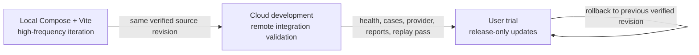

# Capstone development and release lifecycle

This document is the normative description of how Capstone is developed,
validated, and exposed to users. Railway service names, domains, credentials,
and deployment revisions are operational details owned by the [Railway
runbook](../../deploy/railway/README.md); this document defines the boundaries
that those details must preserve.

## User data compatibility

User data compatibility is a development and release requirement. Versions of
one user-local installation share its PostgreSQL ledger and artifact storage.
Preserve existing conversations, models, reports, evidence, private configuration,
and volume identities when registering an existing installation with the manager.

Changes to persistent formats require an explicit format version, supported
upgrade paths, and tested migration and recovery procedures. Release verification
must use data written by supported older versions and check reads, reports and
evidence replay after upgrade. Container health alone does not prove compatibility.
Declare and test rollback support separately; an upgrade result does not prove
that an older version can read the resulting data.

Before stopping the active service, the version manager checks the target
release's compatibility declaration against the installation's data format.
Missing or unsupported compatibility blocks switching and preserves the current
service and data. Do not bypass this gate by creating empty replacement volumes,
deleting data, or asking the user to repair the database. Implementation and
verification receipts must support a release's compatibility claims.

## Three execution lanes

### Development integration and release branches

`dev` is the default integration branch and owns current project control,
canonical worklists and generated PROJECT-OVERVIEW.html. Main copies are release
snapshots. Feature, fix, docs and chore branches start from dev and target dev.
Experiments preserve their evidence; accepted work enters dev through scoped PRs.
Existing unmerged branches are assessed individually, without bulk rebases.

`main` owns accepted release baselines. A release branch is optional: freeze a
selected dev candidate when a stabilization period is needed. Main PRs run full
release verification. Hotfixes start from the actual accepted deployment tag;
accepted fixes flow to main and back to dev. A successful merge is not a
deployment receipt. Branch pushes do not automatically promote user trial.

The phase-complete conversation application is maintained as a main release baseline.
Enterprise autonomous execution advances on dev after the Pi experiment is integrated.
Pi names the underlying executor ecosystem, not a permanent application delivery branch.
Open focused research branches when needed and return accepted changes to dev. Future
conversation-oriented development remains possible without maintaining a second permanent
development branch. Release scope and exact delivered artifacts remain distinct from dev progress.

Both dev and main require PRs and zero mandatory approvals; force push and deletion
are blocked. During development, dev requires `verify (macos-latest)`; ordinary
feature PRs also run on macOS. Main requires both `verify (macos-latest)` and
`verify (ubuntu-latest)`. Linux remains a supported user-trial platform and must
pass full release verification before delivery. Administrator emergency
bypass remains available and must be recorded if used. Local-dev normally follows
a recorded dev source, with explicit temporary feature candidates allowed.
Cloud-dev validates selected development sources. Local-demo and cloud-demo
remain on accepted demo tags unless a recorded release or repair candidate is
being verified. Stage data isolation and exact source/image promotion still apply.

Capstone has three lanes with different risk and data responsibilities:

| Lane | Purpose | Allowed change rate | User exposure |
| --- | --- | --- | --- |
| Local | High-frequency implementation and interaction testing | Every working-tree change | Developer or explicitly shared LAN only |
| Cloud development | Remote integration, worker wake-up, provider, App, and evidence validation | Development revisions after local gates | Internal testers and registered cases only |
| User trial | Stable release presented to users | Release tags or explicit promotion of a verified revision | Registered scripted cases; explicitly selected open Thread workbench |

The local lane is the fastest loop. The cloud-development lane is a remote
verification target, not a second production environment. The user-trial lane
is a release surface and must remain stable while development continues.

Cloud development must wake on access without an operator start. Its idle
policy balances the total bill, cold-start latency, task reliability and state
safety. A small measured database baseline is acceptable. Use platform
Serverless sleep for API and family workers after idle/wake validation. A
small static App can stay running to keep the first page reliable;
an idle process alone still retains billable memory. Workers must not keep
the stage awake by polling an empty ledger. Keep development push triggers
disabled when deployments are controlled explicitly. Retain database history,
the volume and artifact bucket. Manual deployment removal is a maintenance
action, not acceptance of automatic sleep. Validate the resumed stage and its
source identity before an acceptance tag. User trial remains independent.

## Verification scope during development

Local iteration runs the checks affected by the edit. Use, for example,
`make check-iteration CHECK_TARGETS='test-capstone-app'`. A backend change selects
the relevant Python tests and its application entry smoke check. Do not repeat
all offline, E2E, packaging and release checks after each edit. Local API, worker
or App changes still use the canonical local rebuild before deployment claims.

During early product development, an ordinary edit must not trigger hours of
unrelated verification. Select checks for the changed behavior and its direct
consumers. Reuse recorded successful checks when source and relevant contracts
have not changed. Do not repeat the same full suites at every local, PR and
control-document boundary. Record elapsed time and narrow an incorrectly selected
gate instead of waiting indefinitely. Complete release and cross-platform checks
remain explicit baseline/release work.

The conversation-runtime gate covers native conversation/context/diagnosis
resources, the native executor image, and the explicitly registered shared
research-context mirrors. It checks the named affected backend modules and their
HTTP, Work, worker and research-status consumers rather than collecting the whole
agent suite. The source allowlist and named tests must agree; an uncovered backend
module mixed into a conversation change selects the wider product gate. It also checks App/build, client contracts,
native SDK fixtures, types/boundaries and targeted native image contracts. It does
not run unchanged solver, Pack, Kernel, deployment-installer or full professional
application suites. Its selected step has a10-minute ceiling; this ceiling is a
failure bound, not a target duration. A mixed change to foundation composition,
Authority, solver or unknown dependencies still selects its owning wider scope.

The source-topology gate checks the fixed application source-display provider,
its protected transport adapters, and their direct consumers. Its exact source
and test allowlist includes backend HTTP/Thread/native/gateway consumers, App
tests/build, client contracts, native fixtures, types/boundaries and targeted
image contracts. The allowlist also registers model workspace controls and Thread service state:
the same gate runs the complete Thread and host consumer suites, including
last-model release, active-task guards and professional-model retention.
Transport qualification compares Python ASTs: only the named
source-forwarding methods and public source error codes may be added; any change
to existing transport behavior still selects product verification. Gateway policy
qualification permits only the exact read-only topology and model-inventory
allowlist additions. The MCP adapter, task relay and SDK gateway wrapper are
registered with their existing gateway, native, host and Thread consumers.
Model inspection, build or artifact permissions still select the wider gate. Unknown,
foundation, Authority and dependency changes retain their wider gates. The
selected step has a10-minute failure ceiling, not an expected duration. Record
its actual CI duration. This gate does not run unrelated professional solvers,
registered workers, Kernel, Pack or release-installer suites.

The adaptive-agent gate covers the named lightweight-loop and research adapters,
versioned research policy assets, and the two registered Kernel research ledger
and channel modules. It runs the complete agent, registered-worker, Kernel, App,
client and research Pack checks, plus native SDK fixtures and types/boundaries.
Its15-minute ceiling is a failure bound. Exact source registration is required;
unknown Kernel, Authority, solver, runtime and dependency changes cannot use this
scope. This avoids unrelated professional solver suites for research-loop work.

Dev PRs and pushes select documentation, bounded governance contracts, source-topology, conversation-runtime, adaptive-agent, shared-agent,
foundation or native-runtime dependency regression, or `make check-pr` on macOS. Python source/tests
under capstone-agent and TypeScript/TSX/CSS under capstone-app/src use the shared-agent
gate: package boundaries, global type checks, complete agent and Kernel suites,
App tests/build and client tests. This includes registered worker regression.
The selected test step has a15-minute limit; timeout fails the check. Its duration
must be measured in CI, not assumed from local timing. An explicit file allowlist
in `tools/ci_scope.py` selects foundation checks for Kernel profile/composition
and their professional application adapters. This gate retains the shared-agent
checks, the pandapower Pack, the complete PyPSA application suite, inventory
conformance/multi-binding tests and the hosted/Thread/diagram adapter tests.
It also has a 15-minute step limit. It does not cover arbitrary Kernel changes.
The wider native-runtime gate covers protected MCP gateway configuration,
Compose wiring, the MCP sidecar and changes combined with foundation assembly.
It retains the foundation gate, then checks deployment contracts, native inventory
delegation, both capture wrappers, PowerMCP audit contracts and all native SDK test
fixtures. Its additional step has a 10-minute budget. This avoids running unrelated
solver suites for a host transport edit. MCP dependency updates qualify only when
semantic comparisons of the manifests and downstream lock files show no other
dependency changes; a solver change hidden in a lock still expands the gate.
Changes to professional delegation contracts, Domain Packs, other Authority code,
other Kernel code, unrecognised dependencies/build files or
unknown paths still require the broader product gate. Mixed changes select the
broader gate. Documentation/governance changes cannot hide product changes.
Unknown paths require product regression;
main PRs and pushes run `make check-release`. Feature
branch pushes do not run a second copy of the PR workflow. New revisions cancel
obsolete automatic runs for the same event and ref. The PR gate checks formal
applications, Authorities, Domain Packs, Kernel, App and registered workers.
It excludes the old grid CLI suite, full validation suites and distribution
installation checks. Daily development runs only `verify (macos-latest)` to keep
iteration short. The job names remain stable when Linux is included for release.

Baseline and release acceptance explicitly run `make check-release` on both
platforms through the `verify` workflow with `release=true`. A successful PR gate
does not prove baseline or release acceptance. Existing deployment verification
and exact source/image promotion requirements still apply.

Issue automation uses the trusted development policy's macOS CI requirement only
when the actual PR target is dev. Main, explicit release checks and missing or
unknown target context require both macOS and Linux; a macOS-only result cannot
pass those checks. The PR target comes from GitHub's PR response, not the local
policy reference or a caller's deployment label.

The application no longer requires compatibility with the `grid-agent` CLI.
Its package still holds runtime modules used by the formal pandapower worker.
Move those modules to their owning application before deleting the old package.
The old suite remains in the explicit release aggregate during that migration;
this is a temporary verification reference, not a public compatibility promise.

## Server resource lifecycle

A durable Thread is a database record. It does not reserve a worker or keep a
model in memory. New Threads allocate execution resources only when work is
claimed. Each Attempt starts its runtime on demand and stops it on success,
failure or cancellation. RPC work has a finite deadline.

Model preparation is a process cache shared across Threads. An Attempt pins its
resources during execution. Idle resources remain available while memory has
headroom; container and host memory pressure reclaim the least recently used
idle contexts first. Active work must never be evicted. The count ceiling is a
separate defensive bound, not a limit on opened models or a normal eviction
target. An explicit idle timeout remains available, but the shared runtime
contract disables it. The worker also checks pressure while idle and closes its
cache on shutdown. Durable Thread history and model workspaces survive resource
eviction. Currently, a subsequent Attempt still prepares the registered model
again; prepare-on-open and verified fast restoration are pending lifecycle work.

The API limits concurrent Thread event subscriptions, including a limit for
each Thread. Disconnects and cancellation release subscription capacity. Worker
wake throttling for reads uses one process timestamp rather than a growing
session map. Each accepted Thread command sends a wake without that throttle,
so fast consecutive work cannot be stranded after the worker drains its queue.
Page entry waits for database and worker readiness and streams a bounded
component projection before enabling the workbench. Browser presence alone
does not retain compute. An inactive page releases subscriptions while keeping
its local workspace; renewed intent prepares components before writes resume.
Active tasks retain their lease. Recovery must preserve drafts and reading
position, without replacing a loaded conversation with a sleep screen.
The older compatibility host retains its bounded session pool and idle timeout.

Hosted images bake bounded Authority catalog exports for their immutable
registered models. The catalog payload is included in the installed artifact
identity and checked on startup, avoiding a full model-library reload on each
wake. Missing or mismatched metadata is fatal. Current model opening, mutable
Context state, results, evidence and live family availability keep their
existing Authority and admission checks. Family startup probes run concurrently.

The shared limits and deadlines belong to
[`configs/runtime/host-runtime-v1.json`](../../configs/runtime/host-runtime-v1.json).
The local and cloud stages must select the same tested policy. Private worker
health reports retained and active context counts so validation can confirm
resource release while a page remains open.

Resource eviction does not delete database history, results or evidence. These
records use persistent storage, which can grow independently of process memory.
Automatic record deletion requires a separate retention contract. Preserve
existing data while that contract is deferred.

Native resource profiles and installations have a separate persistent lifecycle.
The general Pi service retains accepted role revisions and immutable Linux
installations in its profile and resource volumes. A new image adds its tested
installation at the final runtime path; it does not relocate an existing venv or
replace accepted bytes. Profile revocation, absent bytes or incompatible executor
identity fails an old task explicitly. Process-cache eviction does not delete
these resources. Backend Authority resources are installed independently in that
backend image; task startup never installs dependencies. Stage isolation applies
to these private volumes as well as the ledger and artifact storage.

## Common foundation fixes across the two development lanes

The supported CI acceptance runtime is Python 3.12. Run the release checks on
Linux and macOS with that runtime. Do not add another Python version to the
matrix without an explicit support requirement and acceptance scope.

### Paired local and cloud environments

The local lane has two isolated targets. `local-dev` serves `cloud-dev`:
implementation, local integration tests and development deployment validation.
It may run a recorded development candidate ahead of cloud-dev. `local-demo`
serves `cloud-demo`: reproduce the released behavior, test emergency repairs
and validate planned release candidates. It is not a second daily dev target.

At rest, local-demo uses the exact accepted cloud-demo source and enabled
feature scope. A repair starts from that source; a planned release uses a
frozen, verified main candidate. Record the baseline, candidate, purpose and
differences while local-demo temporarily runs ahead of cloud-demo. After release,
keep it on the accepted release source; after a rejected or deferred candidate,
restore the current cloud-demo baseline after checking data compatibility.
Never delete existing local data to restore source alignment.

The pairs define responsibilities, not automatic deployment or shared data.
Do not make the local versions equal solely for convenience. The same revision
is valid when a documented release candidate needs validation in both targets.
The control view shows each actual revision, its paired target and any pending
alignment; a planned source must not replace the observed deployment record.

The local development and cloud-development path is one lane; the local demo
and cloud user-trial path is the other. Before deliberate parallel development,
record an accepted common foundation baseline. The present development/demo
feature differences do not themselves establish that alignment.

Public foundational fixes must reach both lanes. Intent contracts, goal
completion, answer admission, evidence linkage, failure diagnostics and common
response policy are shared behavior, not demo-specific patches. Maintain one
canonical implementation and common regression cases; application-owned adapters
may accommodate different feature sets without changing their shared semantics.

Record the common patch identity, its dependencies, each lane's target source
commit and verification receipts. A port must include its dependency closure.
Do not claim completion when one lane lacks the node, contract or runtime wiring
needed to activate a fix. If compatibility requires different semantics, resolve
the shared foundation before accepting the common repair. Independent feature
work must not duplicate these contracts or bypass Authority admission.

Local-dev is the daily development and integration entrypoint. After a local
source change, rebuild and validate the affected local-dev path. Local-demo
retains its last accepted source; do not update it for each development change.
When a user release is planned, freeze a tested main revision as the release
candidate and deploy it to local-demo for product acceptance. Keep the two
stages' databases, storage, runtime state and credentials separate. A shared fix
uses one canonical implementation, but its development acceptance does not
claim that demo has received it. Demo delivery requires its own release receipt.
Emergency repairs use the demo-compatible candidate in local-demo as part of
their repair task, with separate receipts for propagation and release.

Source propagation and cloud release are separate actions. Each hosted stage
retains its own required verification, exact role identity, promotion/rollback
rules and acceptance tag. A common fix does not authorize simultaneous cloud
deployment. An explicit local-only task must remain local-only.

Reader-facing environment identifiers are `local-dev`, `local-demo`, `cloud-dev`
and `cloud-demo`; keep product version and source revision alongside them. These
labels do not rename internal stages or change release permissions. Implement
the labels in a future authorized release, as requested by the user.

The accepted branch and merge workflow, common-fix return paths, two-step
baseline alignment and current environment identities belong to the fixed
[version-control register](../status/VERSION-CONTROL.md). Read and update that
register before branch integration, baseline changes, verification, release or
rollback. Development environments may enable isolated experimental features;
integration into main is distinct from user-trial acceptance. Native Pi and
skills work remains experimental until its recorded integration gates pass.

The control graph and execution documents are maintained in both directions.
Source, branch, PR, verification and deployment changes update the register and
graph. Scope, ownership and sequence decisions made through that graph update
the owning design, implementation plan, canonical worklist and working-branch
copies. Keep implemented, verified, merged and released states distinct. A graph
edit alone does not complete the corresponding project adjustment.

User feedback and AI-assisted repairs follow the normative
[Issue workflow](capstone-issue-workflow.md). GitHub Issues owns feedback and
discussion; PRs and verification receipts own implementation evidence; the
version-control register owns branch, baseline and release relationships.
The first delivery is command-driven: the current AI session may read,
communicate and repair when requested, and may remind at relevant work
boundaries. It does not enable scheduled or unattended execution, independent
paid model calls, automatic main merges or cloud deployments.

## Isolation invariants

Cloud development and user trial are separate deployment stages. They must not
share any of the following:

- PostgreSQL databases or `DATABASE_URL` values;
- artifact buckets, S3 credentials, or artifact endpoints;
- operator tokens;
- public API/App origins, allowed-origin lists, or domain bindings;
- mutable run, session, or evidence data.

API and worker within one stage share that stage's ledger and private artifact
storage. They must run the same tested backend source revision or the exact
same backend image digest. The App is a presentation client: its
`VITE_API_ORIGIN` contains only the selected API origin and never a token,
Provider key, bucket credential, or other secret.

Provider credentials are separate by default. The current function-validation
stage permits use of existing Provider credentials, as explicitly requested by
the user. This exception changes no database, bucket, operator-token or evidence
ownership. Provider secrets remain in protected backend environment variables.

The App reads the selected access mode from `/api/v1/thread-access`.
`CAPSTONE_THREAD_OPEN_ACCESS=true` opens the workbench and its Thread operations
without a browser token. Local Compose selects this mode by default; cloud
development selects it explicitly after local verification. Other deployments
retain operator access unless explicitly configured. The older public demo
credential remains limited to registered scripted cases and does not grant
Provider access. Ordinary conversation in open mode uses the worker's configured
Provider; it does not use that older demo credential.

## Promotion protocol

Normal local Compose and cloud development use the same versioned
[`host runtime profile`](../../configs/runtime/host-runtime-v1.json) and
`deploy/launch_host_runtime.py`. The profile owns application selection rules,
role commands, Provider/model selectors and startup dependencies. Environment
values supply stage-specific infrastructure and credentials. Conflicting
runtime selectors fail before application startup. API startup waits for both
family workers; subsequent catalog and admission checks refresh worker health.
The deployment receipt records contract, source artifact, installed artifact
and architecture without secrets. Contract and source identity must match
local acceptance and all cloud backend roles. Installed identity includes the
Authority catalog and must match within each stage, and across stages with the
same architecture. Generated-model floating-point revisions can differ on ARM
and x86; this does not relax exact model revision or snapshot checks.
Base images use pinned multi-platform digests and package installs use locks.
Capacity and infrastructure can differ; application semantics must not.
Bounded scripted validation is an explicit separate mode, not this profile.

Every user-trial update follows this sequence:

1. Run the smallest focused checks, then the required local gates. For API,
   worker, or App changes, rebuild with `make capstone-local-rebuild` so the
   running services use the current checkout.
2. Deploy the exact source revision to cloud development. Do not validate one
   revision and promote a later working-tree state.
3. Verify API readiness, App health, a registered scripted case, a Provider
   case when a separately authorized Provider key is configured, report
   generation, evidence replay, and API/worker revision identity.
4. Record the verified commit or image digest and promote that exact artifact
   to the user-trial stage under a release tag or an explicit release action.
5. Recheck the user-trial health endpoint and one registered public case.
6. If any release check fails, roll back the user-trial stage to its previous
   verified revision. Investigate the failure in cloud development or locally.

The user-trial stage must not follow ordinary development pushes. Its release
action is deliberate and reviewable. Cloud-development automatic deployment is
acceptable when it is limited to the development stage and still uses the
verification protocol before promotion.

## Change and credential rules

### Main branch integration protection

`main` requires pull requests and the `verify (ubuntu-latest)` and
`verify (macos-latest)` checks from GitHub Actions. Force pushes and branch
deletion are disabled. Required approving reviews are zero; Code Owner reviews,
last-push approvals, strict branch updates and linear history are not required.
Administrators retain emergency bypass; ordinary integration follows the checks.
The independent publishing App has no routine bypass. This protects integration
without adding full release gates to local iteration. Baseline and deployment
acceptance remain separate requirements.

### Credentials and local work

- Keep local runtime state, caches, model assets, and authentication state in
  ignored paths. Do not copy them into another lane or commit them.
- Put versioned runtime configuration in `configs/runtime/` and deployment
  variable names in the Railway examples. Put actual credentials only in the
  owning environment or ignored project state.
- Never put Provider or operator secrets in command arguments, logs, source,
  static App variables, simulator environments, or answer/evidence artifacts.
- Do not use cloud development to inspect, migrate, or repair user-trial data.
- Preserve unrelated work and user data while cleaning the repository; stage
  only task-owned files and never delete main-worktree `var/` data.
- Record a durable decision or deployment boundary in
  `docs/status/JOURNAL.md` when it changes how future work must proceed.

## Operating references

- [Repository agent contract](../../AGENTS.md) — mandatory constraints for
  agents and future changes.
- [Railway deployment runbook](../../deploy/railway/README.md) — service
  topology, variable checklist, health checks, and promotion operations.
- [Runbook](../RUNBOOK.md) — local rebuild, hosted App, and deployment entry
  points.
- [Current state](../status/CURRENT-STATE.md) and
  [next-session handoff](../status/RESUME-NEXT-SESSION.md) — volatile status;
  do not use them to redefine these invariants.
