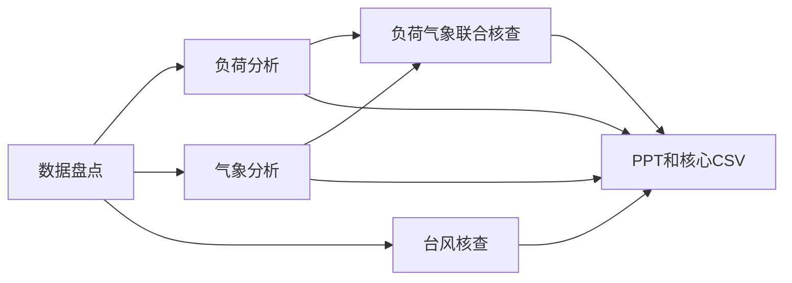

# 同题迎峰度夏研究：轻量循环与 DR

状态：两次真实模型执行和文件核对已完成；均为有限业务成果，不是正式业务结论验收。

本次 DR 增强了探索覆盖与联合分析，但没有显示效率优势，也没有自动保证最终
结论可靠。轻量漏查了实际存在的台风记录、主对比图有错误；DR 找到了台风、
纠正了跨年图轴，却留下指标语义、单位及综合表述问题。默认轻量、用户显式选择
DR 的方向合理；不能把“多分支、多文件、更多请求”直接当成质量增强。

## 结果总表

| 项目 | 轻量循环 | DR |
| --- | ---: | ---: |
| 执行耗时 | 383.658 秒（6分24秒） | 843.856 秒（14分04秒） |
| 主模型响应 | 65 | 10 |
| 子模型响应 | 0 | 147（6个任务） |
| 全部模型响应 | 65 | 157 |
| 工具调用 | 88 | 204 |
| SQL调用 | 27 | 62 |
| 工具错误返回 | 10 | 21 |
| 模型请求累计活动时长 | 294.030 秒 | 主89.166 + 子965.260 秒 |
| 工具活动区间并集 | 70.772 秒 | 140.622 秒 |
| 报告页数 / 嵌入图像 | 14 / 6 | 15 / 8 |
| 发布文件 | 16 | 40 |
| 累计输入 token（非缓存部分） | 299,017 | 474,596 |
| 累计缓存读取 token | 3,704,192 | 7,137,664 |
| 累计输出 token | 53,021 | 206,563 |
| 累计总 token | 4,056,230 | 7,818,823 |
| 最大单次输入上下文（含缓存） | 114,583 | 主77,085；子114,809 |

DR 耗时为轻量的2.20倍，请求数2.42倍，累计总token约1.93倍。
token 是每次请求读写量的累计，含反复读取的缓存，不是独立资料量，也不是费用。
Provider返回的费用状态为unknown，不据此推算实际账单。DR 并行区间重叠，模型
累计时长、工具并集与总耗时不能直接相加。错误返回含工具菜单/参数、SQL和脚本
错误，并不等于同一个业务节点被门禁拒绝21次；两次均自动修正后完成。

完整可复核时序见[执行路径CSV](2026-10-27-summer-comparison-execution-path.csv)，
共514条：222次模型响应、292次工具调用。表中不包含私有思考文本。

## 固定条件

- 相同指令：[原文](2026-10-27-summer-comparison-prompt.txt)。文件 SHA-256：
  `deb571d10671d5f3848e733af5053d8027b91cfffd2d82da51d74c4cd7c0dc80`。
  工作台去除末尾空白后，实际指令 SHA-256：
  `d3f126381daf74a6d46cd9a3fb1aa8b9cde84813702c305c73ddea0c7ab2e03f`。
- 两个新会话，无上传文件，无显式历史成果引用。不继承前次研究产物。
- 本机后端源提交 `7b1d9c19`；镜像
  `sha256:9ca5136edc64ba12e46e4681a34d06fc60b7fdbc6035bd8b35e07b23cbf1baaf`。
  规范重建、API/worker 身份和就绪检查已通过；清理记录
  `.capstone-agent/cache-maintenance-20261027-234833-13755.log`。
- 通过 Vivaldi 的现有工作台标签提交。顺序：轻量先，DR 后；不并发抢占模型。
- 后端模式字段分别为 `false` 和 `true`。DR 子任务仍可使用获准的普通执行工具。
- 已对比两次 admitted submission：唯一不同字段为 `deep_research`。
  `resource_profiles`、`_native_execution` 完全相同；指令完全相同。
  两次没有 objects、material_refs、attachment_refs 或内联资料。
- 同一 `deepseek / deepseek-flash`，相同config_revision `91cb19d3…`、
  executor_revision `46849ed9…`，相同Pi锁与应用/资源绑定。

## 预先固定的检查项

| 项目 | 验证内容 |
| --- | --- |
| 实际交付 | 10—16 页 PPTX、核心 CSV、工作台可打开 |
| 年份 | 2026 为今年；历史替代明确，不冒充今年 |
| 可比口径 | 同时间窗口、对象、单位、指标定义；缺测明确 |
| 分析范围 | 国网整体、重点省份、负荷、气温、降水、台风 |
| 证据 | 本次网关来源、实际数据覆盖、图表与 CSV 可追溯 |
| 结论 | 区分数据观察、相关性和因果；不能取得的结论写明 |
| 执行路径 | 发现、取数、清洗分析、制图、生成、校核、交付的先后及依赖 |
| 成本与耗时 | 全部主/子模型请求、工具请求、重试、重复取数、启动及收尾 |

检查限于实际保存的成果与本次可见数据，不冒充完整业务审定。
一组随机模型运行只提供探索性比较；运行顺序、共享网关缓存和模型波动均是限制。

## 轻量模式

- 会话 `thr_29e40e5648ea8a4efdd4`。
- 执行 `attempt_d8d12373f42699f0`。
- 2026-10-27 23:51:53（北京时间）开始。后台已确认模式 `false`。
- 原始事件及 admitted snapshots：忽略目录 `runs/summer-comparison-20261027/lightweight/`。
- 已完成，执行区间 23:51:53.228815—23:58:16.887270，383.658 秒。
  65 次主模型响应，0 次子模型响应。14 页 PPTX、6 张图、两份核心/气象
  指标表及派生数据和复现脚本，共发布 16 个文件。Vivaldi 右栏已渲染封面，显示 1/14。
- 路径：入口进度说明；网关工具发现/加载；业务和数据能力发现；目录与表结构
  检索；SQL 检查覆盖、指标、数据源与对象；SQL 拉取负荷/气象；本地分析；
  修正脚本数据类型；生成图表与 PPT；检查文本/尺寸；修正图轴单位；保存交付。

| 时间（北京时间） | 实际动作及结果 |
| --- | --- |
| 23:51:53 | 提交；开始同一智能体循环 |
| 23:51:55 | 首次工具调用（+2.645秒），说明任务并搜索工具 |
| 23:52:00起 | 发现业务/数据能力，检索目录和表结构；分批加载工具 |
| 23:52:21—23:56:09 | 27次SQL调用，核查年分区、对象、指标、来源、覆盖，拉取负荷/气象 |
| 23:56:20 | 派生负荷、气象和小时轮廓CSV已整理 |
| 23:56:47 | 写分析脚本；执行遇到对象ID/年份数据类型问题，修改后继续 |
| 23:57:20—23:57:50 | 检视指标并生成PPT脚本；此轮模型响应30.051秒 |
| 23:57:51 | 生成14页PPT |
| 23:57:56—23:58:10 | 检查文本/尺寸，修正图轴单位，生成产品清单 |
| 23:58:16.887 | 交付完成，无追加指令 |

优点：全程维持同一执行上下文；`list_object_metrics` 查询到了11032001的
“电网发受有功”定义与MW单位，发现多个来源后锁定0021990100，明确作负荷代理。
15个对象均按29天对齐。独立复算15行峰值/同比，与保存的日度CSV一致，峰值取整
误差不超过0.5MW；这只证明派生计算一致，不证明代理口径等于目标业务负荷。

实际问题：

1. 主负荷同比图按2024/2025实际日期绘制，未叠加同月同日；纵轴固定950—1230GW，
   截掉2024同期11/29天、2025同期1/29天。脚本检查了尺寸和文字，却未识别比较图失效。
2. 文字搜索的契约明确为字面子串匹配，检索无结果不能证明库中无相关数据。
   一次后续目录查询还返回Tool not found。报告仍断言1131张可读表中“无任何台风
   数据”；同网关随后DR查到了SG_COM_TYPHOON_B，因此该结论不可靠。
3. 虽写“相关不等于因果”，结论页仍以江苏负相关推断产业结构与气温敏感性差异，
   没有独立的产业结构证据；以样本内降水差异判定旱涝，缺少气候基准。
4. 两次工具未加载、加载超过8项、SQL参数及本地脚本错误等共10次错误返回。
   模型请求65次也已不少，轻量不等于一次模型回答。

## DR 模式

- 会话 `thr_e86cb36eec2efb6dac51`。
- 执行 `attempt_b3caef238dd7fd17`。
- 2026-10-28 00:03:30.194753（北京时间）开始，模式 `true`。
- 与轻量模式跨过午夜，但固定业务指令中的年份和日期未改变。
- 首个子任务 `discover_inventory` 在 00:03:46.249118 启动，距执行开始 16.054 秒。
  主链首先调用plan，未先在主链完成取数。00:17:34.051212完成，无追加指令。
- 原始事件及 admitted snapshots：忽略目录 `runs/summer-comparison-20261027/dr/`。

任务图实际结构：

| 阶段/任务 | 起止（北京时间，10月28日） | 耗时 | 模型响应 |
| --- | --- | ---: | ---: |
| 启动至首任务 | 00:03:30.195—00:03:46.249 | 16.054秒 | 纳入主链总数 |
| 数据盘点 | 00:03:46.249—00:06:58.131 | 191.882秒 | 32 |
| 读取盘点、追加计划 | 00:06:58.131—00:07:53.333 | 55.201秒 | 纳入主链总数 |
| 负荷分析（并行） | 00:07:53.333—00:13:54.133 | 360.801秒 | 35 |
| 气象分析（并行） | 00:07:53.620—00:12:14.179 | 260.559秒 | 36 |
| 台风核查（并行） | 00:07:54.068—00:09:45.287 | 111.219秒 | 20 |
| 联合核查 | 00:13:55.088—00:15:26.453 | 91.365秒 | 13 |
| PPT/CSV综合生成 | 00:15:27.827—00:17:11.225 | 103.397秒 | 11 |
| 生成任务返回至正式交付 | 00:17:11.225—00:17:34.051 | 22.826秒 | 主链最后1次 |

关键路径是盘点→负荷→联合核查→报告；气象和台风虽并行，不能缩短盘点及
后面两个串行任务。盘点阶段还要求核查电量、电网模型等超出本题必要范围的能力。
盘点不是最小数据准备，而是一份近16KB的独立调查报告；随后主链又阅读它、生成
长计划，其中一次依赖声明错误引起重写。34.956秒写计划后，又用了14.411秒修正。

这次没有反复接收、校核、拒绝业务结果的慢循环：

- 六次返回事件到成功状态可见，约0.177—0.830秒。
- 最后一个负荷输入返回→联合任务启动0.955秒。
- 联合任务返回→报告任务启动1.374秒。
- finish工具2.651秒；finish返回→attempt完成5.150秒。其后没有模型请求。
- 主链没有调用普通bash去接手重算，没有单独record/assess模型调用。

因此，本次主要慢在任务分解后的实际模型工作与返工；不能再笼统归因于
“主链接结果几分钟”。21次工具错误中主链3次（进度字段、引用读取、依赖声明），
盘点2、负荷8、气象6、联合核查2。错误未阻断最终交付，但造成额外请求。

可见增强：

1. 找到台风定义表，2024暑期17行按名称等字段去重为6个个例，保留起止时间
   冲突、登陆点/预警缺失，并与华东五省负荷作事件窗口对照，没有编造2025/2026台风。
2. 10省、3大区和国网合计负荷；96点典型日；气象覆盖更多观测单元和逐旬变化；
   联合核查包含负荷水平/日变化量、工作日、滞后和滑动均温的不同检验。
3. 年度曲线按月日叠加，限制与来源比轻量更详细。综合任务复用了上游CSV与图，
   没有重新取数；联合任务也复用了两个输入分支的成果。

仍有重要缺陷：

1. 盘点明确跳过`list_object_metrics → discover_metric_sources`语义路线。
   负荷分支选择11012001的理由是覆盖广、量级大，定义和单位未核实；轻量则取得
   11032001语义与MW单位。DR主体又采用多源行的两级聚合上界估计，台风分支使用
   11032001。来源页披露了差异，但这些数值不能当成统一业务口径使用。
2. 部分表/图写“量测值/疑似MW”，回归页却直接写MW/℃，丢失单位不确定性。
   独立复算14对象同窗口峰值和同比与本任务日度CSV全部一致；这不验证其业务定义、
   多源聚合的等价性或“上界估计”的业务合法性。
3. CSV复算：三区同时≥35℃在62天为16天、29天为8天。PPT对应页有区分，
   正式回答却把8天写在62天叙述中，综合摘要产生窗口混淆。
4. 三区峰值日7/3、7/4、7/5，跨度2天；PPT却写“差≤1天”。气候基准缺失仍出现
   “伏旱”“较常年”所需证据不足的强判断；“空调负荷占比高”也没有分项负荷证据。
5. 图片比轻量更完整，但综合四联图的日期标签拥挤。两份都需要用户继续修订，
   未达到无须审阅即可正式汇报的质量。

Vivaldi已实际渲染两份PPT封面及页数。发布字节SHA-256核对轻量16/16、DR40/40一致。
核心数值检查基于保存的日度派生表，不是独立重跑原始数据库的专业审定。

## 比较结论

这次复杂任务中，DR带来了实际的覆盖增强，最直接证据是补上了台风个例；但它
用2.20倍时间和2.42倍请求完成，而且仍有语义与综合错误，不能称为明显稳定的整体优势。
默认轻量适合先交付、持续交互；需要多方向深入探索时，用户可显式选择DR。

下一步优化应落在这次的具体瓶颈上，而非增加更多校核模型：

1. 将前置盘点缩成足够启动的准备；有关证据与任务逐步扩展，避免先交一份百科式清单。
2. 分支前共享明确的对象、指标定义、单位、来源选择、窗口和聚合规则。不能因指标
   “量级大、覆盖广”就将其解释为负荷，也不能让最终生成任务重新解释业务语义。
3. 子任务输出可直接消费的紧凑数据、图表、结论与限制，减少长中间报告和重新讲述。
4. 用确定性检查核对图轴、窗口、单位标签、峰值日期跨度及摘要/表格一致性；
   对实际缺口记录放行，避免转化为重算和重试的门禁。
5. 修正已观察到的工具菜单加载误用、追加计划依赖与引用读取契约问题。

本轮只执行和分析，不修改运行中算法或事后修好任一产物来改变胜负。单次顺序试验
不能证明普遍因果优势；第二次可能受缓存影响，两次模型自行选择的方法与探索深度
也不同。确认的是本版本在此真实业务题上的行为、耗时和可复核的成果问题。
