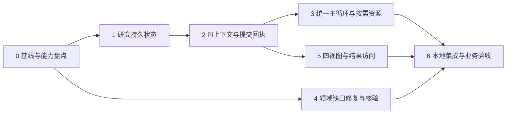

# 自主智能体首期实施计划

> 执行方式：当前会话按任务顺序推进；不自动启动并行代理。

**Goal:** 从当前dev建立一个主Pi循环，完成一条需要自主组织的业务指令，支持必要追问及可追溯结果。

**Architecture:** 沿用Application、Domain Pack、Kernel、Authority四层。五概念对应研究状态、笔记、现有工具与同一主智能体的行动/评估，不新增五个服务。

**Tech Stack:** Python Kernel/应用/Authority、受管Pi与JavaScript扩展、React/TypeScript App。

状态（2026-10-13）：候选092acb6；主循环、研究工具、失败记录、App接口已有实现。隔离API8889/App5199同源，三角色同镜像f0f6f14c；三个真实API任务均完成回复与记录收尾，耗时40／379／73秒，结果与失败项可在浏览器打开。可交人工观察，但完整业务目标与解释准确性未全通过；概况原句21秒、5次只读查询，约10秒目标未达到。稳定local-dev5173和demo不变，整体目标仍未完成。设计依据为[统一设计](../specs/2026-10-12-autonomous-agent-design.md)。
本计划明确交付及检查，不将未验证的能力组合写为已可完成；领域新算法须在盘点后形成独立能力实现设计。

## 全局约束

- 每条指令必须保存用户可理解的正式回复；失败、部分完成、能力不足和取消均需说明执行结果。
- 局部校验失败不得否定整个任务。使用核验正确的结果，保留核验失败的记录；数量超限不等于计算失败。

### 容量与失败链路检查（2026-10-13）

| 范围 | 已确认行为 | 状态 |
| --- | --- | --- |
| 回答、跨轮引用、结果投影证据 | 统一1024；工具引用收集取消128条截断；真实131条证据重放接纳19项投影 | 565874e已验证，未部署 |
| 引用事件与终态传输 | 引用事件支持2MiB；大表继续分片；1024条链路与App协议通过 | 已验证，未部署 |
| 超过回答容量 | 1025条测试保留全部工具回执，交付可共同核验的部分并说明限制 | 已验证，未部署 |
| 局部核验失败 | 去掉仅检查16组的限制；合并核验失败保留兼容部分 | 已验证，未部署 |
| 请求路由失败、取消 | 保存可读正式回复；不会仅保存错误码 | 已验证，未部署 |
| 研究状态更新 | 单项引用32、结论64、笔记64、开放问题32；工具返回失败可供继续处理 | 已定位，容量与恢复仍需检查 |
| 结果展示容量 | 64项、8MiB、单表128行；展示失败不得影响已核验正式回答 | 仍需检查终态边界 |
| 时间、事件字节、存储故障 | 持续检查恢复和完整记录；持久化失败不能虚报任务已保存 | 尚未整体核验 |

上述检查不替代三个业务样本验收。保留真实失败与未验证项，不以理想答案为验收要求。

- 实施起点为当时最新dev；整理时根工作区为4f15cfc，产品恢复基线为6ff7094。
- 保留Pi38e19db、Research2b0b0a5及R0参考，不整分支移入旧分类/任务编译机制。
- 系统指令通用，不加入三条样例或历史错误对应的专门路由与提示。
- 精确工具契约、授权、Authority事实、当前运行证据准入及答案持久化保持有效。
- 先验证原有普通问答、模型概况、潮流、对象解析和结果追问，再替换入口。
- 保留用户数据和独立local-demo；本计划不授权云端或demo升级。
- 正式回答 / 执行过程 / 计算结果 / 推演证据；保留三条短窗、小字号、完成折叠和完整滚动窗口。
- 本地迭代运行相关检查，不等待GitHub CI才进行本地验证；合并与发布仍执行对应门禁。
- Python验证使用项目基线3.12，不增加3.14矩阵；新工作区显式选择3.12。
- 实时Provider验证若涉及新的付费调用，遵守仓库授权规则；离线契约检查不能冒充真实业务验收。

## 依赖和完成定义



这是依赖图，不要求并行开发。按用户最新确认，先执行0→1→2→3→4以及任务6中的三个专项任务链路验收；三样本链路通过后，再执行任务5与任务6中的前端交互验收。
当前优先级是三个专项的任务链路，不以页面可操作或工具调用结束代替样本通过。
链路验收逐项检查工具编排、用户约束、计算结果、证据关联、失败处理及最终结论；
支持有依据的部分结果或能力缺口说明，但不得把未完成要求或未经证实的推断标为成功。
既有前端修正保留，后续前端扩展与交互验收暂后置。
用户进一步明确：重点是实现完整。三样本验收不要求答案完美或穷尽所有研究路径，
要求实际能力被完整、真实地交付：指令进入主循环，执行与失败处理有结果，
研究状态、产物和证据保存可追溯，最终回答说明已做、未做、失败和未验证的部分。
不为追求标准答案增加固定工作流或无限扩大优化范围；也不以测试通过代替闭环完整。
2026-10-13再次确认：立即形成可人工验证的候选；交付前只集中检查这三个专项的内容、耗时、证据与过程，不无限扩展问题修复。失败或未找到最优解如实呈现，未经验证的判断须明确其局限。
研究状态保存成功不是研究任务完成；框架正确报告能力缺口也不是三个业务问题全部通过。

## 任务0：冻结可复核基线与能力盘点

文件：configs/capabilities/pandapower-3.4.0-static-analysis.json；
packages/grid-simulator/src/grid_simulator/capabilities/definitions/；
docs/reviews/2026-10-11-deployment-answer-samples.md；
新增docs/reviews/2026-10-12-autonomous-agent-capability-baseline.md。

- [ ] 记录dev提交、两参考分支、受管Pi锁定身份及现有工作区状态，保留未提交设计文档。
- [ ] 从历史业务验证中提取概况、潮流、line7、母线31负荷变化、潮流后排名、中英文混杂及耗时回归项。
- [ ] 经公开Authority契约核对IEEE39成本/可控出力/约束/OPF输出，记录实际列和单位。
- [ ] 核对mv_oberrhein两线路身份、原始连通性、短路参数、设备额定值及已发布稳定性方法。
- [ ] 每项标为源码契约确认、实际执行确认或缺口；保存命令、返回身份与失败，不只写PASS。

已静态确认：opf.ac、支路N-1、IEC60909、revision.derive、结果查询/比较已发布。
未确认：指定算例全部输入齐备、最优缓解的建模与回验覆盖、可满足所求的电压稳定性方法。
能力矩阵没有独立电压稳定性发布条目；不能用潮流收敛或电压合格替代。

## 任务1：最小研究状态及重放

修改：packages/capability-agent-kernel/src/capability_agent/application/context_models.py、
context_reducer.py、context_store.py；
新增application/research.py及tests/application/test_research.py。

输入：运行时绑定的研究/Attempt身份、expected_revision、request_id、有界修改及已准入引用。
输出：已提交research_revision、当前视图或冲突/拒绝原因。request_id与内容摘要进入同一持久事件。

- [x] 增加旧记录重放、相同请求重试、相同请求不同内容、版本冲突、非当前Turn迟到更新及并发竞争测试；Attempt终止检查由任务2宿主接入补齐。
- [x] 实现目标、条件引用、判断与来源、开放问题、笔记；不存原始模型表或大型结果。
- [x] 更新仅产生研究记录，引用通过宿主传入的准入回调；实际Authority接线属于任务2，不自签数值事实。
- [x] 验证写入中断后恢复，复用ContextStore事务机制；条件变更使旧判断待复核。
- [x] 20项研究测试、完整Kernel590项及类型检查通过，提交8d636a4。

命令：
```sh
uv run --project packages/grid-agent pytest packages/capability-agent-kernel/tests/application/test_research.py packages/capability-agent-kernel/tests/application/test_context_store.py packages/capability-agent-kernel/tests/application/test_context_reducer.py -q
```

## 任务2：Pi研究工具、上下文和可靠回执

当前进展：宿主RPC独立控制请求入口及ResearchRequestChannel已实现。
私有通道由宿主绑定研究/Turn/Attempt，is_active回调拒绝新迟到请求；
重复及不确定回执可从原持久事件只读查证；视图发布先于成功回执。
模型不能选择路径或身份。Pi扩展注册与上下文钩子已接线；实际App生命周期与Authority准入回调属于任务3。
Python3.12完整Kernel609项、Pi工具60项与全仓Python类型检查通过。
实际受管Pi离线传输验证通过，不代表真实Provider业务验收。

修改：Kernel runtime/rpc.py、runtime/descriptor.py、tools/catalog.py；
packages/pi-capability-tools/src/domain-tools.mjs；
新增同包src/research-tools.mjs及test/research-tools.test.mjs。
测试：Kernel tests/runtime/test_rpc.py及新增研究提交通道测试。

- [x] 通过专用受管目录发布有界更新请求；参数不接受文件路径。
- [x] 在RPC等待及事件处理处调度独立研究请求处理器，不依赖轨迹capture开关或tool结束。
- [x] 调用任务1持久更新，之后生成回执；重复请求返回同一修订。
- [x] context钩子装入一份有界最新视图；在受控请求边界检查必需修订，避免钩子异常被Pi吞掉后继续。
- [x] 用实际受管Pi的离线可控传输验证压缩/恢复后的请求内容，不只检查磁盘文件。
- [x] 测试静默等待、持续事件、回执丢失、取消、重启；客户端轮询20ms，宿主RPC轮询25ms，端到端性能留待任务3/6测量。
- [x] 运行相关Kernel、Pi工具与类型检查并提交；不修改现有轨迹确认文件含义。

```sh
uv run --project packages/grid-agent pytest packages/capability-agent-kernel/tests/runtime/test_rpc.py -q
make test-generic-tools
```

## 任务3：统一主循环和轻量资源装配

2026-10-13：73244c0在首次模型资源准备时读取已发布的context.get概况，以绑定修订提供输入元数据；不更改能力默认值或固定回答文案，不把输入总量作为已解出的运行结果。实际初始上下文验证包含该数据，但概况126.773秒复测失败。d1767ff修正初始研究目标缺失的确定拒绝被误报为未确认的问题，并返回可读错误。通用目标范围原则限制自行增加研究目的，但保留用户要求；不增加意图节点或关键词路由。耗时目标仍待真实复测。

用户新增优先约束：局部错误必须进入恢复或结果交付，不能仅报错码结束。
先修通这条结果路径，再扩大自主工具装配。详细契约见统一设计“故障处理也必须完成用户结果交付”。

88206b4首段实现：回答准入异常向原Pi会话反馈一次，沿用剩余时间；准备/执行失败交付
客观结束说明，已准入结果和证据继续显示。后端166项、前端116项通过。
下列总体验收项仍未勾选：混合坏引用隔离、其他准入门禁、取消/租约中断、存储故障恢复
及真实API/浏览器业务验证尚未完成。没有部署。

b73c4f4补充核验失败事件与原文分块保存、结果面板失败卡片；混合引用按返回组核验后
合并复验，最多16组，完整执行历史不删除。后端168项/前端117项和类型检查通过。
用户明确“失败本身也是结果”；仍须补齐详细原因、产物查看与智能体后续处理的贯通验证。

d9f1879保留工具失败原因；ec913ac统一回答准入门禁的失败观察与同会话继续处理，
并保存应用请求、关联已有轨迹序号。后端173项及类型检查通过；工具原因展示67项前端通过。
用户进一步要求整条执行链保存和追溯。现有私有轨迹保存工具参数与结构化返回，
但受控查看入口、上下文快照/产物完整性及应用生命周期尚须核验，不以摘要日志代表全部完成。

- [ ] 工具/校验错误以有界观察交还主智能体，按预算恢复；不以绕过校验代替处理。
- [ ] 保存可交付的部分成果；任务状态与结论有效性分别表达，后续失败不清空已有有效内容。
- [ ] 结束时交付完整、部分完成或受阻的客观结果；Provider不可用时有基于记录的应用保障。
- [ ] 跨API和前端验证失败终态仍呈现正式结果、执行记录、已验证结果与证据；错误码仅在技术详情。

接线核对：当前prepared profile按模型Context复用，其Kernel workspace身份不等于Thread run；
不能直接复用profile的账本来代表每个Attempt。App必须显式绑定研究身份、Turn与Attempt，
沿用Thread租约/取消检查；每个研究引用复用领域的事实准入，不能仅凭工具事件中出现引用便接受。
这些是实现前核对结果，尚未接入。

修改：packages/capstone-agent/src/capstone_agent/kernel_pi_session.py、thread_worker.py；
Kernel application/runner.py及所需公开配置契约。
测试：packages/capstone-agent/tests/test_kernel_pi_session.py和Kernel tests/application/test_runner.py。

- [ ] 保存既有入口回归结果；以应用配置启用候选，不按用户语句选择新旧路径。
- [ ] 解开Pi会话启动必须取得完整prepared profiles的限制；先装配有界身份/能力/方法索引。
- [ ] 将资源分成版本化静态契约与运行态数据；静态资源可复用，运行态依模型修订及授权核验。
- [ ] 复用授权工具集与guide_open，原子能力执行仍经过同一Domain Pack/Authority。
- [ ] 只在关键研究变化提交状态；不增加逐步评审模型或入口完整任务编译。
- [ ] 简单问答直接完成；连续指令沿用可适用结果，条件变化派生场景并重新核验相关判断。
- [ ] 验证一般Pi委派保持隔离；仅迁入必要模块，未授权业务文件和原始对象不得进入其工作区。
- [ ] 测量准备、首次模型响应、首工具、计算、正式回答和总耗时后提交。

```sh
uv run --project packages/capstone-agent pytest packages/capstone-agent/tests/test_kernel_pi_session.py -q
uv run --project packages/grid-agent pytest packages/capability-agent-kernel/tests/application/test_runner.py -q
```

## 任务4：领域能力缺口与证据核验

所有权：Authority实现/验证数值能力；Domain Pack定义方法、判据和投影；Application选择发布。
触及文件限于任务0证实的能力缺口；不因样例失败直接改固定概况文案或系统提示。

- [ ] OPF回归：完整线路和节点输出、边际价字段、单位/货币来源、原始求解状态。
- [ ] N-1缓解：核对故障覆盖、优化目标、可调对象、切负荷代价、功率平衡及0.95–1.05约束。
- [ ] 用优化所得实际控制量派生场景并做AC回验；逐故障纠正方案不标为全故障统一预防方案。
- [ ] 双停运：同一修订包含两个停运动作，对比原始与派生拓扑，区分连接分量、失供区和可持续带电孤岛。
- [ ] 短路：真实参数和设备额定值齐备才判断超标；缺失逐项记录。
- [ ] 稳定性：必须有明确研究量、有效模型与已发布方法；若缺失，形成独立可复用能力设计和验证后再发布。
- [ ] 不用更换措辞掩盖算法/数据缺口；保留部分完成状态，三个业务问题仍未全部验收。

受影响能力完成后运行其定向测试，再运行：
```sh
make test-simulator
make test-domain-package
```

## 任务5：四视图与完整结果访问

2026-10-13：8eb81aa接通原任务记录的App只读分页。420项App测试与类型通过；真实浏览器读取原C03指令、模型修订、两项工具和终态，未发送修改请求。内部事件页自动跳过，每次操作至多8个请求。原参数、研究判断和结果仍用既有证据面板。此项不代表自然语言追问绑定、完整结果分页或最新后端同源验收。

2026-10-13：dab1dbe按已准入结果分组展示证据、保留失败记录并定位计算结果；a3895a5将已提交研究判断、笔记、开放问题及来源引用保留为原任务修订快照。412项App及69项后端、33项任务传输检查通过；实际保存记录的浏览器回放通过，手机/桌面无溢出。人工候选5199仍为092acb6；此处未完成新版本同源部署、完整工具参数追溯和结果分页验收。

新增用户要求：整体概览覆盖原目标、成功/失败/未执行环节，让用户知道可追问的内容；
展开不堆叠日志与全表。详见设计“整体概览与任务细节追问”。
54f6f13提供受保护的原任务记录分页，返回原指令、模型快照和有界事件（含失败/诊断）；
真实PG19项、HTTP及管理36项和类型通过。尚未接App追问或完整私有轨迹读取。
a77e180新增前端任务记录解析与HTTP读取，13项和类型通过；不代表任务概览或追问交互完成。
- [ ] 建立任务/结果/执行项的显式追问绑定，保持原模型修订；自然语言仍由同一智能体理解。
- [ ] 解释性追问只读已保存记录；条件变化另建执行并关联原任务，不覆盖历史。
- [ ] 测试模型切换后追问、失败原因追问、无新增仿真、缺失记录说明及按需分页。

修改：capstone-agent的host_api.py、thread_protocol.py、result_projection.py、kernel_pi_session.py；
capstone-app的threadProtocol.ts、CapstoneAssistantThread.tsx、threadEvidenceState.ts；
测试：test_thread_http_api.py及相关App组件测试。

- [ ] 保留现有短窗/完整工具链，把正式回答与中间进展保持分离。
- [ ] 新增受授权Thread结果分页；公开result_id/table_id映射到已准入结果，不接受任意Authority地址。
- [ ] Domain Pack投影保留原查询、单位、修订与总行数；前端翻页不启动LLM或仿真。
- [ ] 推演证据按结论/检查项关联实际工具、参数、结果及判据，不从回答正文猜引用。
- [ ] 旧记录缺少细粒度关联时如实显示；引用存在不等于业务检查通过。
- [ ] 验证大表分页、失效游标、权限拒绝、场景切换、重连及失败状态，桌面/手机检查。

```sh
uv run --project packages/capstone-agent pytest packages/capstone-agent/tests/test_thread_http_api.py -q
npm test --prefix packages/capstone-app
npm run check --prefix packages/capstone-app
```

## 任务6：本地集成与交付

### 用户指定的本轮整体回归（2026-10-12）

以下是整体功能回归，不替代历史失败样本。真实应用入口执行；基础组使用已打开的
IEEE-39，组合组在同一对话按顺序执行，模型和结果状态不得逐条重置。

| ID | 原始指令 | 时间目标 | 核验重点 |
| --- | --- | --- | --- |
| B01 | 帮我介绍一下当前电网的基本情况，以及你能做哪些分析 | 通常约10秒以内 | 当前模型事实与已开放能力正确；不混入无关能力缺口，不启动无需求的计算 |
| B02 | IEEE-39 有哪些母线和线路？ | 通常约10秒以内 | 基于当前模型列出可识别对象；数量、范围及分页说明正确 |
| C01 | 打开 IEEE-39 网络并解析线路 11 的端点。 | 通常约30秒以内 | 正确打开/复用模型，解析对象和端点；不因重复准备丢上下文 |
| C02 | 执行一次交流潮流。 | 通常约30秒以内 | 在当前模型计算并完整呈现主要已算结果；有对应证据 |
| C03 | 沿用当前潮流结果列出负载率最高的三条线路。 | 通常约30秒以内 | 复用C02结果、按实际负载率排序；不重新计算潮流，不要求补对象集合 |

每条保存源提交、环境身份、会话/Attempt、实际回答、工具轨迹及结果/证据引用。
记录总耗时、首个可见反馈、首个工具调用、准备、模型请求、工具执行及回答输出耗时；
不能取得的阶段标为未采集，不估算。区分首次与连续调用，保留失败首跑，重试不能覆盖。
约10/30秒是正常体验目标，不是超时后截断回答的硬限制；明显超出须定位原因并登记。
内容正确性独立审核，不能仅靠关键词、耗时或终态成功判定通过。

专项从已保存的三个复杂原始问题中选择本次修改涉及的条目，清楚列出验证机制和断言。
不扩展成要求三个问题全部完美回答；未执行项明确记为待验证，能力缺口不冒充业务完成。

- [ ] 更新整体业务样本集，保留历史失败；专项只检验本次修复的机制，不强求无关回答完美。
- [ ] 对三个原始问题和必要的改写/追问执行真实链路验收；记录冷/热启动、每阶段耗时和重复调用。
- [ ] 区分框架验收、业务完成、界面验收；不因缺口表达正确就宣布业务完成。
- [ ] 集成候选运行make test、make test-e2e、make validate；日常小改动不重复全套。
- [ ] 使用make capstone-local-rebuild更新local-dev，确认API/worker/App身份，再执行部署专项及相关整体样本。
- [ ] 保存实际回答、轨迹、结果/证据引用、失败与耗时报告；检查通过后才交人工验证。
- [ ] 更新版本台账与控制图，受保护dev按PR合入；核对两参考分支后决定归档，未合入内容保留。

## 本轮计划检查

- 五概念覆盖：任务1研究模型/笔记，任务2接入主会话，任务3行动与评估，任务4实验能力。
- 四视图和技术追溯：任务5；性能、连续指令、历史回归：任务0/3/6。
- 首期不包含新的通用工作流引擎、跨Thread研究管理、真实设备控制或自动云发布。
- 任务4新增算法的完整实现范围取决于真实能力/数据盘点，不预先承诺三个问题全部可算。

## 首期范围收敛：单指令研究状态优先

最新讨论明确：首期Research Model服务于一条复杂业务指令的目标、条件、尝试、结果、核验和缺口。
独立研究身份保留扩展能力，不据此引入多研究管理。暂缓当前研究选择器、多研究切换与跨任务自动归属。
此前相关选择器章节保留为后续设计参考，不是首期交付要求。当前界面仅需任务名称、进展、模型/场景关联和结果。
必要补充及结果追问关联原任务；首先完成单指令主循环、三个专项任务链路和对话执行入口。
此收敛不减少五概念、真实计算、失败记录、证据追溯或三条业务验证要求。

## 最新首期关系：每个电网上下文的缺省研究

覆盖此前“一条指令一个研究”和多研究选择器的首期安排：同一Thread内，每个电网模型上下文
对应一个缺省Research Model。用户不必创建或选择研究。切换电网联动切换，切回恢复已有研究。
指令仍各自保存目标、执行、场景和结果，不能把前一任务的条件或结论无条件移入下一任务。
同一电网的场景修订保留在关联研究中；旧判断按原版本有效，改变条件后需重新核验。
现有按Attempt隔离的实现尚不满足此关系，需改为稳定研究存储加独立Attempt通道。
前端保持电网切换、任务标注与结果展示，不增加研究选择器。

## 研究状态重置与后续回退

用户要求首期考虑研究状态重置，高级版支持回退至指定状态。
重置清空后续推演使用的目标、判断、笔记和缺口；保留历史任务、研究变更、计算结果和证据。
重置不修改电网数据，也不删除历史研究。重置作为可追溯的状态变更，保留前后版本关联。
运行中不直接重置，先结束或取消任务；后续请求从当前电网状态开展研究。
指定版本回退属于后续能力；研究状态回退与电网场景回退分别处理，禁止隐式联动数值模型。
当前尚无用户侧重置入口，不能把已有ledger重放误报为用户可用的重置或回退功能。

## 最新重置边界：电网与研究上下文联动

用户进一步明确重置应考虑电网状态。默认“重置当前工作上下文”同时恢复电网至明确的打开基准，
并清空供后续推演使用的当前研究状态；保留全部历史指令、场景版本、执行、失败、结果与证据。
电网恢复通过Authority产生或选择可追溯的恢复版本，不能覆盖原场景。执行中先结束/取消任务。
“仅清空研究状态”保留为次级方案，不在首期强行新增界面。此前“重置不改电网”仅适用于此次级动作。
重置的实际Authority语义、跨存储失败恢复和用户入口尚未实现，需验证后才可声明交付。

## 应用迁移收尾要求

用户已取消 grid-agent CLI 兼容要求。迁移仍被调用的应用装配、模型绑定和部署入口到 Capstone Application，删除旧CLI入口与依赖，同步说明和验证命令。保留 gridctl/grid-simulator 的 Authority 职责。此项尚未实现，不得以改名代替依赖迁移。

## 2026-10-12 当前验证边界

候选ec10790：75e485d增加已准入的OPF/N-1/拓扑/约束投影，回放1206个显示值与Authority逐项一致；6196ac3提供核心推理深度调整并通过实际Pi压缩恢复检查；ec10790提供完整筛选集合的数据聚合，通过68项及类型检查。
真实基础五题收据 `runs/autonomous-live/deepseek-basics-1791814329/report.json`：39.25/17.879/16.729/32.077/11.91秒，末题复用潮流未重算。第一题8.1GW与工具6254.23MW不符，英文过程说明进入最终消息，不能认定通过。
复杂N-1收据 `runs/autonomous-live/deepseek-n1-1791810357/report.json`：317秒，原46场景扫描完成，但最终声称两个方案均独立AC核验与调用记录不符，且不可推出全局无可行方案。孤岛收据 `runs/autonomous-live/deepseek-island-1791810357/report.json`：170秒，缺短路数据与动态稳定方法的失败原因已交付，数值/表述仍需审核。三个专项整体与API/worker实际App执行未验收。
新增聚合后的真实基础复验进程84590已启动，收据在新的deepseek-basics目录；不可混用旧收据声称新版本业务通过。

聚合后复验84590已结束：`deepseek-basics-1791814887/report.json`，48.899/24.264/17.903/33.535/12.662秒。负荷合计通过，发电机合计仍与原始9行不符（5620被写成6220MW），核对保存在同目录numeric-audit.json。基本任务仍不通过，不把工具升级视为回答核验完成。

## 实际入口验证候选55fb4ce

245874f概况查询已被真实智能体使用，发电/负荷合计正确；基础样本31/14/14/38/13秒及英文前缀仍未通过。OPF47.83秒、35线路/39母线电价、265展示值逐项与Authority一致，研究更新缺引用错误暴露诊断缺口；34ec456补字段诊断，待实证恢复。
55fb4ce将显式研究开关传入API及双worker，默认关闭，通过30项入口检查。独立Compose项目capstone-autonomous-validation正在规范重建，端口8889、独立数据库/对象卷，原local-dev/demo不变；后续App5199及真实API任务执行待验证，不是已部署成功。

## 95d7929 空闲释放后真实结果复用

隔离API/双worker同镜像c8f5593、research1、实际上下文空闲60秒，App5199。新Thread真实交流潮流16.263秒，等待65秒后“沿用当前潮流结果列出负载率最高的三条线路”24.842秒。四项读取成功，无求解器调用，准入结果引用与前轮相同；21/11/26排名及73.37/67.15/65.73正确。收据位于 runs/autonomous-live/api-app-95d7929/idle-reuse-receipt.json，同目录保存全事件/终态及环境身份。此项不证明容器重建数据恢复、N-1约束满足或三个专项整体通过。

### Actual island API semantic audit — source95d7929

Thread thr_d95e848be8501b550bc9 completed in80.054s. Driver88407 is terminal. Full events and semantic audit are preserved under ignored runs/autonomous-live/api-app-95d7929/island-case-1.json and island-semantic-audit.json. The task delivered a final answer after failed tools, but business acceptance fails: Ybus NaN does not prove the asserted cause; null voltage does not prove physical zero voltage;21 unsupplied buses are not established as one connected island; source contribution and location claims require scope verification. Do not weaken numerical/reference verification to pass this sample. Investigate exact result reference for the branch-ranking integrity failure before changing its reader.
