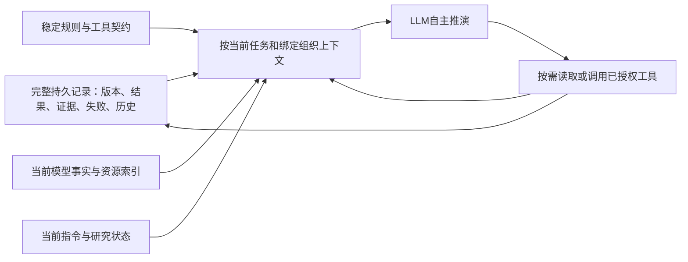

# 自主智能体设计讨论

## 2026-10-13：模型能力上下文生命周期补充

已确认：打开模型时准备能力上下文，会话内持续可用；切换模型复用对应准备产物，资源回收后快速恢复。新对话纳入同一worker的内存调度，可变电网状态、研究记录、授权及结果按Thread/Run隔离；只读定义可按源版本复用，不能共享可变实例。内存不足按最近使用顺序回收空闲资源，活动资源保持固定。默认空闲时间不是回收依据，缓存数量只是独立防护边界。

实现反馈：03b8d96已完成内存压力调度及运行配置同步，92项检查通过，未部署。打开时准备与经过身份核验的快速恢复尚未实现；现有保留工作目录仍重复准备。后续先补生命周期，再验证新对话、模型切换、内存回收、连续任务，分别记录耗时和命中，不以缓存策略通过冒充整体闭环。

当前收敛方案见[自主研究统一设计](2026-10-12-autonomous-agent-design.md)。
本文件保留讨论沿革；早期名称和范围以统一设计中的现行约定为准。

状态：工作提案，详细契约尚未定稿，未实现。日期：2026-10-12。

用户要求由助手主导深入到可支持设计实现，逐轮接受纠偏。
本文保存具体设计、取舍与验收行为；[控制台账](../../status/VERSION-CONTROL.md#自主智能体演进讨论)
仅保存全览。[演进笔记](2026-10-07-capstone-core-evolution-discussion.md)保留历史依据。
不能将用户允许继续讨论记为每项细节已经批准。

## 设计缺口与讨论顺序

当前前端名称（用户确认）：正式回答／执行过程／计算结果／推演证据。
历史段落中的“回答”“结果明细”“验证依据”“证据”为讨论沿革，不作为现行界面命名。

2026-10-12最新优先级：先完整完成单条用户指令，同时设计最小多轮补充/追问支持。
后文“完整跨轮管理后续”指多研究自动组织等扩展，不排除必要澄清、结果追问和条件补充。
以本轮D15为交互范围准绳，避免将首期误解为无上下文的单问单答。

2026-10-12最高层设计约束（用户明确）：以整体五概念形成简洁、通用的设计与实现，
再验证其是否能解决三个问题；不能反过来围绕三个问题改出专用实现。
五概念是职责抓手，不要求五个独立模块、服务或模型。
工作节点、状态操作、方法索引等均是可裁减的实现提案，不能自行演变为另一套框架。
前文“能力盘点”只核对已注册能力与真实缺口，不允许据此增加样例专用路由、
系统提示或执行脚本。新增领域动作须可复用；复杂结构没有明确必要性则不引入。
后续按五概念说明最小职责和协作关系，再做源码映射和样例验证。

2026-10-12用户纠正并明确：研发从当前dev新基线开始；本次记录时dev为4f15cfc，
运行产品恢复来源为6ff7094。demo仅用于说明用户已观察到的交互效果，不是源码起点或实现来源选择。
长期设计针对通用自主研究框架；三条指令是首批端到端验证集，不定义支持范围、任务类型枚举或分发逻辑。
首期交付收敛与长期架构完整性分别处理；精确实施起点在创建实施分支时重新核对dev。

2026-10-12本轮范围校正：用户确认试用demo已有工具调用链能够体现业务解题思路，
S01当前实现已满足用户要求。本轮以业务逻辑正确和合理耗时为重点，复用现有展示，
不把新进展界面或完整研究事件系统作为首版交付前置。以下较完整呈现设计保留为后续方向。
S01按用户反馈登记为现有能力基线；这不是本轮独立复验或新的部署认证。

2026-10-12最新收敛：用户指定D03的三条原始指令为首版优先业务集。
其他历史出错样例保留为回归，不能用扩大框架范围推迟三个场景的端到端交付。

2026-10-12优先级修订：用户明确首个实现目标为一次复杂指令的自主推演闭环。
长期架构保留研究/场景/执行身份；完整跨轮关联、跨研究检索与复杂协作不作为首版前置。
先用真实复合任务验证状态、动作、证据、进展与结论的一体闭环，再扩展连续研究。

1. 研究状态、身份、更新与跨轮连续性：本轮工作提案。
2. 行动策略和进展评估器：候选行动、选择依据、停止与失败恢复。
3. 实验工作台与业务基座：组合、委派、编程、能力发现与证据交接。
4. 任务级进展流：事件、用户表达、恢复、修订与最终回答。
5. 最小端到端切片、样本与延迟预算、分支迁移和实现计划。

以上为讨论顺序，不是产品必须逐步经过的工作流。

## D01：研究模型的最小可执行结构

### 身份和生命周期

- Thread保存对话；Research保存可延续的问题及认识；Scenario保存一组适用条件；
  Attempt保存一次执行尝试。研究节点是一个有目标的工作单元，可包含一组工具调用。
- 一个Thread可以关联多个Research；一个Research跨多轮和多次Attempt。
  首版不主动扩展跨Thread共享，但保留独立研究身份。
- 新消息到来，由主智能体结合有界上下文提出延续、条件分支或新问题；
  不要求每轮增加一个独立分类器。只有歧义实质影响行动且无法从上下文解决时才询问用户。
- 普通查询只需当前工作上下文；形成需要延续的场景、实验或判断关系时按需建立Research。
  采用已有动作和来源引用建立记录，不能事后虚构研究过程。
- 本轮答复完成不等于研究永远关闭。Research可保持可延续状态；
  一次Attempt可因回答完成、受阻、预算或用户停止而结束，原因分别记录。

### 最小内容（逻辑对象，不预定数据库表）

| 对象 | 必要内容 | 生成和核验责任 |
| --- | --- | --- |
| 问题 | 目标、范围、版本、关键未知 | 模型提出/修订；保留用户原始要求和变更来源 |
| 场景 | Authority模型引用与修订、对象引用、条件、方法/标准来源 | 框架绑定身份与版本；Domain Pack核验领域适用性 |
| 判断 | 内容、类型、适用场景、证据关系、当前状态 | 模型可以提出；引用和领域核验不能由自我声明绕过 |
| 工作节点 | 局部目标、输入依赖、实际工具/委派引用、结果、局部完成依据 | 模型组织；运行时登记实际动作和回执 |
| 缺口 | 未知内容、影响目标、可选解决方向、是否阻塞当前结论 | 模型评估，可被观察修订；不要求所有缺口清零 |

字段允许逐步补足。类型和证据规则在执行或发表相应判断时生效，
不能恢复为入口必须完整编译业务任务的门禁。
研究笔记作为独立自由文本材料链接上述对象；笔记中的说法不会自动成为已支持判断。

### 判断与证据

分别保留三种关系：depends_on表示适用性依赖，supports/refutes表示证据支持或反驳，
observed_after只表示先后。首版不要求图数据库。

区分猜想、采用的条件假设、实际观察和分析判断。
建议状态为待检验、有条件支持、被反驳、待重验。
支持程度与适用范围分开：一个结果引用通过校验，不代表自然语言解释已经证明。
模型可以提交判断；数值事实必须来自已接纳Authority结果，派生分析保留方法和输入来源。

场景变更不使旧结论在旧场景变假。新场景继承的相关判断标为待重验；
反例则修订被反驳判断本身。方法、约束与模型版本变化均需检查依赖。
无足够细粒度依赖信息时保守标记受影响集合，不能声称能够精确复用。

### 状态更新和运行恢复

建议以版本化状态变更及追加事件保存研究演进，当前视图由已提交记录组成。
复用现有ledger、trajectory与artifact机制，具体存储接口下一阶段核对，不另起事件平台。
模型提出变更，运行时核验引用/版本/权限并提交；用户进展从已提交事件生成。

一次变更携带research_id、expected_revision与幂等身份，冲突时读取新状态后重新判断。
实验执行与研究提交不能假设跨系统原子事务：先保存执行身份和回执，
再接纳结果并更新研究。提交失败后的恢复核对原执行，不盲目重算或重放副作用。
父节点与委派结果绑定各自输入版本；迟到结果不得覆盖当前场景。
事件数据和用户说明可以异步投影，但未持久化的数值发现不能冒充已提交结果。

### line7设计示例（无本轮计算结果）

1. 保留用户原目标；按真实对象解析结果绑定线路和模型版本，不能靠示例字符串硬编码索引。
2. 识别已有基准是否适用。当前运行证据接纳成功后复用；不适用或缺失才按需计算。
3. 在受支持的派生场景中执行停运实验，登记条件、方法和回执。
4. 接纳实际结果，检查收敛、数据完整性与线路阈值覆盖。
   无阈值可展示负载率而不宣称越限校核完成；不收敛不等于已经证明严重越限。
5. 形成仅适用于该场景的判断；阶段成果可先呈现，最终回答说明结论及未覆盖范围。

用户追问前三条线路：沿用场景并读取适用结果排序，不因新Attempt而自动重算潮流。
用户变更负荷：形成新场景，旧场景保留，受影响判断待重验。
用户追问原因：现有排序作为观察；原因是新解释问题，需要相应支持，不自动升级为因果结论。

### 可验证行为

- 多轮追问能定位原研究、场景及结果；适用且已接纳时不新增潮流计算。
- 变更条件后不会混用旧场景的结论；旧场景仍可重放和比较。
- 支持证据撤销或发现反例时，相关判断修订有来源记录，用户能看到修订说明。
- 普通概况不强制建立完整研究模型、提出假说或运行实验。
- 同一事件重复投递不重复写入；中断恢复不因状态缺失而盲目重算。
- 迟到的委派结果不能覆盖新场景；结果可以作为旧场景记录保留。
- 不能以完整日志或非空回答代替上述业务行为验收；记录真实各阶段耗时。

### 尚待本轮后续检验的取舍

逻辑对象是否足以支持开放研究，应以跨轮、反例和能力缺口案例检验。
不先规定每个任务的完整目标树，不引入固定业务枚举。
下一轮围绕这些对象定义行动策略的输入/输出及进展评估器的判断依据，
再检查本轮结构是否需要调整。

## D02：一次复杂指令的优先交付目标

用户给出的新例子：line149和line59同时跳闸、区域孤岛运行，评估短路电流水平是否超标及关键节点电压稳定性。
这是设计场景，不是当前IEEE39模型中的已解析对象或已执行计算。
验证需选择实际包含目标元件、拓扑及相应数据的模型；不得将线路标识硬映射到IEEE39。

### 首版闭环与范围

收到一条指令后，主智能体从当前上下文和已发布能力组织工作节点，
根据实际观察增删或修订后继节点，持续呈现阶段成果，最终给出各子目标的结论和未完成项。
一次研究内支持多次实验、场景分支、失败诊断、预算停止和恢复；不以前置完整任务树限制探索。
必要且无法从上下文解决的用户输入仍可提出，不能为保持单轮形式编造参数。

首版研究状态可绑定一个请求、一次研究和多个场景；保留独立身份、版本和依赖，
完整多轮研究管理后续实现。现有普通问答、对象解析、潮流与结果复用是回归底线。

### 场景拆解与动态分支（设计示意，不是固定工具脚本）

1. 验证线路身份与故障前场景；在同一子修订内设置两条线路停运，保护原模型。
2. 比较故障前后连通分量。区分新形成孤岛、既有分区和失供范围；多个区域分别登记。
   拓扑分离不能证明能带电独立运行，需进一步检查电源、平衡/控制条件和适用方法。
3. 形成两条可独立推进的研究方向：孤岛内短路水平与设备限值比较；关键节点电压相关评估。
   二者共享经核验的故障场景，但短路计算不一律依赖AC潮流成功；依赖由所选方法确定。
4. 短路方向检查所选IEC60909方法所需参数、故障类型及开断/峰值/热耐受等相应额定量；
   量纲与量的定义必须匹配。缺数据不能补造；能计算水平但缺额定值时保留明确未完成的超标判定。
5. 电压方向区分稳态电压越限、静态稳定裕度与动态电压恢复。
   单点潮流正常不能证明稳定。关键节点来源于用户指定、业务重要性或明确分析依据，
   不能无说明地将最低电压节点等同全部关键节点。
6. 根据观察选择下一步：无新孤岛时修正前提；无持续供电依据时报告该缺口；
   多孤岛时按区域展开；计算失败时诊断而非转成物理结论。最终分别报告已完成与未完成目标。

### 当前能力依据与待核验项

本轮只读核对仓库的pandapower-3.4.0-static-analysis矩阵、公开工具契约及指南：
已登记不可变修订、拓扑连通分量、AC潮流、IEC60909短路计算、约束评估与结果查询。
专门N-1契约限定单支路；本例双停运需经修订组合，不能伪装调用两次独立N-1得到联合结果。
这些登记不等于当前App已经正确组合、模型数据齐备或该复合场景已验收。
矩阵未列出专门电压稳定裕度或动态电压稳定分析，需继续核验/补齐，不能以潮流代替。

能力核对分别记录：Authority执行支持、Domain Pack公开契约、Application启用、当前模型数据、
方法适用性。缺少预置整套工作流不等于不能组合；缺少执行能力也不能靠模型推理越过。

### 验收结构

- 至少一个数据、方法和执行能力齐全的复合场景须真正给出计算结论；不能全部靠报告缺口算成功。
- 对本例若仅完成静态电压筛查，原始电压稳定性目标明确仍未完成，不标记全任务成功。
- 变体覆盖无孤岛、多孤岛、无可持续供电依据、短路参数或设备额定值缺失、
  不收敛及方法能力缺口；观察变化须引起可解释的后继行动变化。
- 保存研究节点、实际调用、模型/场景/方法版本、结果与证据、判断变化、阶段消息和耗时。
- 普通概况、AC潮流、结果排序复用、单线停运、负荷变更以及机组N-1相关历史失败样例进入回归；
  不在提示词和执行器中预写样例答案或线路编号。

### 下一设计缺口

以此例定义一个工作节点的输入、可执行动作、产出、核验和后继选择。
确认最低业务能力补齐范围之后，再确定首版端到端验收场景。
本节优先级已由用户明确；执行策略、数据契约与完整方法范围仍为待审设计提案。

## D03：三条单次请求的业务交付契约

状态：三条原始指令和优先范围由用户指定；下述研究口径、方法与性能指标为待实证的设计提案。
一次回复表示一条请求自主推进到综合结论，过程中持续呈现任务级成果，
不等于用户长时等待一个最终文本，也不等于隐藏必要的参数缺口。

### S01：IEEE39最优潮流与完整结果

原始指令：“帮我算一下最优潮流，并告诉我每一条线的负载率和节点边际电价。”

- 主目标：有效OPF结果、全部线路负载率和全部母线节点边际价格；结果附对象身份、
  单位、目标函数、场景与证据引用。摘要不能代替完整表格，分页或可下载结果也必须覆盖全部对象。
- 建议默认采用AC OPF及算例有效的成本/约束，明确选择；不能静默改成DC。
  检查成本、可调资源、P/Q上下限和结果字段；缺失不补造。
- 节点价格使用求解器实际产生的有功平衡对偶量及其正确换算，核验成本货币、时间基准与单位。
  不能将普通潮流值称为电价，也不能将未注明币种的成本单位写成人民币。
- 验收包含结果覆盖、物理约束残差和求解状态。AC非凸OPF不默认具有全局最优证明；
  按实际求解器保证表述最优性。
- 用户的“几秒钟出结果”为性能目标，不是现状声明。分别记录模型就绪/冷启动、
  首次有意义进展、首个数值结果、全表可用、最终回复耗时，以及LLM/准备/求解/查询耗时。
  不用只计求解时间冒充端到端延迟。先实测再确定门槛。

### S02：IEEE39 N-1与经过验证的缓解方案

原始指令：“对这个网络进行N-1安全校核，如果发现线路过载，请给我一个调整发电机出力或切负荷的最优缓解方案，要保证电压在0.95到1.05之间。”

- 故障集合必须明确。建议首版默认线路及变压器单支路故障，执行前呈现范围；
  该默认属于业务方法配置提案，不能将用户原话永久硬编码成只允许支路。
- 先取得实际故障结果，分别处理过载、失供、不可行和不收敛。
  电压0.95至1.05是用户显式约束，进入场景和优化模型，不只在回答文本出现。
- 建议首版采用故障后逐场景校正方案，标明每个方案适用的故障。
  若要求一套预防性调度覆盖所有故障，则是联合安全约束优化范围，不能由逐场景方案冒充。
- 优化目标建议以最少切负荷为优先，再优化有来源的发电/调节成本；
  方法口径须显式，不能假定任意经济权重。切负荷范围、P/Q关系与资源可调边界需真实约束。
- 将求得控制量落实到故障场景，重新运行AC潮流并复核支路、电压、机组P/Q、
  平衡及实际服务负荷；不能只相信优化器success。
  验证时不得让平衡机或控制器无界补偿而使建议表面可行。
- 显示故障、调节前后出力/切负荷、过载与电压变化，以及方法参数和证据。
  未验证可行的候选不作为可执行建议；不可行明确报告，不擅自放宽用户电压要求。
- “保证”仅限已验证模型、故障与假设范围；局部最优与全局证明分开。
  若仅验证部分故障，不能宣称全网N-1安全。无过载则如实报告，仍保留电压等检查结果。

### S03：mv_oberrhein双停运、孤岛短路与电压稳定性

原始指令：“假设电网发生了一个故障，line149和line59同时跳闸，导致某个区域孤岛运行了，请帮我评估一下当前那个孤岛区域的短路电流水平是否超标，并检查一下关键节点的电压稳定性。”

- 明确选用mv_oberrhein及其场景参数；线路标识经真实对象解析，双停运写入同一派生修订。
  比较停运前后拓扑，区分已有分区、新孤岛、失供和有依据的带电孤岛。
- 孤岛内有sgen不等于具有构网/平衡能力；不得凭空增设外部电网或理想平衡源使计算收敛。
  若原模型实际不支持持续孤岛运行，纠正前提并报告真实后果。
- 短路方向检查源和元件参数、故障类型及相应设备额定值；实际值与定义匹配后判定超标。
  不使用示例文档中的补充参数冒充该模型的真实数据。
- 电压方向保留用户的稳定性目标。建议先呈现稳态筛查，并明确真正的静态裕度或动态恢复
  需要哪种方法与模型；完成筛查不等于完成稳定性评估。
- 关键节点依据用户指定、业务重要性或明确分析指标选取并说明覆盖。
  短路与电压研究在场景明确后可独立推进，不强制每条请求都按同一工具顺序执行。
- 原始场景和补充了公开假设的研究场景分开验收。后者不能替代原始模型结果。
  首版若缺完整稳定性能力，应登记为原目标未完成，并明确能力建设范围。

### 三样例共享机制与验收

研究状态、工作节点、实际观察、后继选择、证据接纳、任务级进展和最终结论共用一套机制；
Domain Pack提供可更新的业务方法、参数口径和验证规则，Authority执行数值计算。
三条提示词不进入系统提示或执行器条件分支，业务测试可以保持原话并增加语义变体。

S01验证编排与结果覆盖，S02验证发现问题后构造并验证方案，S03验证跨分析方法的适用性判断和动态分支。
每个样例分别登记能力、数据、方法、执行、结论、性能是否通过，不能仅以返回文字或日志齐全判定成功。
优先顺序为S01贯通公共闭环，S02扩展优化与回验，S03补齐跨方法研究；
数据/能力盘点可同时进行。具体实现计划尚未制定。

## D04：自主工作节点与观察反馈契约

2026-10-12：用户明确上述步骤应由Agent自主完成。已确认的是自主组织原则；
本节字段和运行机制为工作提案，尚未实现。三个样例的步骤用于缺口分析和验收，
不得转写成生产系统的固定工具脚本。

### 一次决策获得的上下文

原始目标、当前场景及版本、已接纳结果摘要与引用、开放缺口、最近动作与观察、
可用能力/方法索引、剩余执行预算。采用有界投影，完整记录按需读取。
不每轮重复发现全部工具、读取全部手册或重建模型；缓存随能力/模型版本失效，
授权与当前运行证据接纳仍按现有契约执行。

### 工作节点（中性逻辑契约，字段待定）

| 字段 | 含义 | 谁负责 |
| --- | --- | --- |
| objective | 当前要解决的局部问题 | Agent提出，不强制先生成完整任务树 |
| basis_refs | 选择此工作的观察、缺口和来源引用 | Agent选择；运行时核验可访问身份 |
| scenario_ref | 本节点适用场景及修订 | 运行时绑定，不能靠自然语言冒充 |
| actions | 当前已可确定的工具或委派请求，含确切参数 | Agent组织；运行时按公开契约校验与调度 |
| expected_observation | 希望取得什么信息以及局部完成依据 | Agent提出；不是预写期望数值或成功结论 |
| execution_refs | 实际调用、回执、结果和证据 | 运行时写入，不由模型伪造 |

读能力目录等元操作允许没有模型场景；输入尚不明确的未来动作只是候选，不可直接执行。
一个节点可以有多次工具交互，例如先发现结果表结构再查询；遇到需要新观察才能决定的分支，
控制返回Agent。只批量执行输入已明确且无中间决策依赖的动作。
首版保持一个主决策者，独立只读/隔离计算是否并发由明确依赖与资源约束决定。

### 动作、观察与修订

Agent选择下一节点 → 运行时检查当前动作 → 执行 → 接纳实际观察 → Agent判断下一步。
节点可持续补充动作，不要求每次工具调用都创建节点，也不要求每个节点独立启动LLM会话。
工作节点是可解释、可恢复的目标单元，工具调用是其实际执行记录。

执行结果至少分为：成功取得观察、明确失败、执行状态未知。
缺参数、不可行与无能力保留具体原因，不能统称失败后自动重试。
执行状态未知先核对执行身份与回执；明确失败后的重试需有新依据或可重试技术原因及次数上限。
求解器不收敛不是物理失稳证据。

状态更新记录新观察、被支持/反驳的判断、新缺口与已解决缺口。
节点执行成功与业务问题解决分开。例如OPF求解成功但缺节点价格或全部线路结果，
仍需查询/诊断，不能直接终结S01。

### 行动策略与进展评估器

两者是同一主智能体循环中的职责，首版不新增两个模型或强制两次推理调用。
行动策略选择能推进当前目标的行动；必要时比较可行性、信息收益、计算成本和影响范围。
不要求每轮列出固定数量候选，不虚构精确概率或统一加权分数。

进展评估器结合模型解释与可执行核验：运行时/Domain Pack提供执行状态、覆盖、
约束残差、证据来源等真实信号；模型判断这些信号如何回答原始目标，以及下一步是否值得。
领域规则可随方法更新，不能把三个样例的业务语义写入Kernel。
领域知识里的方法是可采用的资源，不是隐藏的强制完整任务树。

下一步可以是：继续读取/实验、修订方法或场景、回答、请求必要输入、报告明确受阻。
这些是循环控制结果，不是入口互斥意图类别。
预算或停止请求由运行时执行，模型不能自行越过；预算耗尽不登记目标已完成。
重复等价调用/无新观察作为停滞信号交给Agent修订；幂等与硬预算由运行时约束，
不能由字符串匹配决定业务研究方向。

### 任务级流式呈现

开始重要工作时说明局部目标，取得有意义观察后发布阶段成果，
修订方向时说明依据。无需每次动作都生成额外模型摘要，优先复用当前回合的简洁说明。
实际数值来自已接纳引用；拟开展动作与已完成事实在事件类型上区分。
原始模型过程文本不直接成为用户进展或最终答案，保留既有过程/最终消息隔离。
持久化、事件次序和恢复接口在进展流专题细化。

### 三样例的分叉验收（不是运行脚本）

- S01成本与数据齐备则直接组织求解和全量结果读取；缺有效成本时明确缺口，
  不编造电价；求解完成但结果尚未覆盖全网时继续取得缺失数据。
- S02实际未过载不启动不必要缓解；过载后自主选择适用方法；候选回验失败，
  依据违反的真实约束修订方案或报告不可行，不伪造保证。
- S03拓扑无新增孤岛则修正前提；短路参数缺失不阻止无依赖的其他有效分析；
  不以稳态电压正常替代稳定性目标。改变观察应改变后继行动。

### 下一讨论缺口

研究节点只解决自主运行的接口，不能凭接口增加数值能力。
下一轮明确领域知识/可组合方法/实验工作台怎样向节点供给能力和验证规则，
并盘点三样例到底缺执行能力、公开契约、数据还是组合机制。

## D05：本轮展示与执行时间边界（用户已明确）

- 在dev实现上复用已有工具调用链、结果及证据入口，以demo的现实效果为体验参照，能够看清“查什么、算什么、
  为什么继续验证”即可；只有影响理解的节点才补简短说明。
- 不新增复杂研究图、进展卡片体系、逐工具LLM摘要或专门讲解代理；
  D04的工作节点首先服务真实执行与记录，不要求同时建设新的可视化产品。
- 长期保留任务级进展方向，但不把完整流式事件协议改造作为本轮前置。
  继续保持过程与最终消息隔离，不能为了展示恢复中英文过程前缀混入正式答案。
- 用户确认S01现有实现已能满足要求，优先复测并保护其行为和耗时，
  不重新实现OPF工作流；新增机制主要由S02/S03的真实缺口驱动。
- 延迟按任务复杂度解释：普通查询和结果提取应轻量；N-1、多场景优化及回验可以更长，
  但时间应消耗在有用计算和必要判断上。未测量前不承诺统一秒数。
- 记录端到端耗时、首次可见工作、准备/LLM/工具与求解/查询/输出耗时；
  并发时区分墙钟与各调用累计时间，不将两者混加。比较同模型版本、同条件和冷/热状态。
- 排查优先级：重复准备和能力发现、重复手册读取、可复用结果被重算、
  无新观察的循环、冗长模型调用、输出阶段等待。计算量大本身不视作回归。
- 业务完成、调用轨迹与耗时一并验收。新版本S01若明显变慢，须找到原因；
  S02/S03以故障数量、候选方案和回验次数解释成本，不能靠减少覆盖伪造速度提升。

下一步从当前dev核对通用运行机制与能力缺口，以三个样例和变体验证通用设计，再形成首期实现方案。
用户此轮没有授权更新demo部署，设计记录不改变环境来源。

## D06：长期通用架构与首期验证范围（用户已明确）

- 基线：当前dev。demo只提供体验参考，不切换到旧运行版本开展研发。
- 框架：问题、场景、工作节点、观察、判断、证据和进展是通用概念；
  Kernel不能出现IEEE39、mv_oberrhein、线路编号或三个样例专用业务分支。
- 领域：OPF、故障评估、缓解方法、短路与稳定性等知识、方法和验证规则归Domain Pack，
  可版本化更新；可执行数值能力由注册Authority提供，Application选择并开放。
- 自主性：Agent按目标和观察组织方法，可组合此前未预置的任务路径；
  方法模板是可选资源，不以样例分类替代自主决策。
- 首期：优先跑通一次复杂请求，保留独立研究身份、场景版本与证据依赖，
  后续跨轮、委派和编程研究可沿契约扩展；不提前实现全部远期功能。
- 验收：三个原始样例之外增加对象、参数、目标组合及观察变化，
  检查是否无须修改路由或代码即可形成合理路径；不新增巨大固定业务枚举。
- 展示：沿用dev现有可理解的运行过程，长期任务级进展方向保留，
  本轮不因展示工程扩大交付；耗时与业务正确性同验。

## D07：dev接入结构与领域方法供给（设计提案）

用户再次确认当前阶段为设计；本轮只读源码并更新文档，无运行实现、分支创建或部署。

### 已核对的dev接入事实

- capstone_agent/thread_worker.py在取得Attempt后调用路由并交给HarnessAttemptRunner；
  pandapower应用hosted.py通过build_lightweight_router装配普通/专业LLM分类。
- capability_agent/application/runner.py通过ProviderSession/PiRpcClient提供会话与语义事件；
  runtime descriptor已有工具目录、指南目录及摘要、上下文视图和轨迹引用。
- application/turns.py的TurnController提供开始、提交、失败及结果/证据接纳边界。
- 以上代码定位支持复用方案，不代表已核验完整生命周期开销或全部缓存行为。

### 建议的运行结构

保持一个Pi主智能体决策循环，Agent按观察选择领域工具、方法资源、研究状态操作或委派。
研究状态以有界视图和少量中性操作接入既有循环，不建立外层逐步调用内层智能体的规划器。
不用“完整规划LLM→执行LLM→评审LLM”作为每条请求的固定流水线。
节点可以包含多轮工具交互；研究状态写入在有意义变化时发生，不强制每次工具调用前后都额外推理。
执行和证据校验继续由原运行时、Domain Pack、Authority承担。

目标自动入口不依赖独立普通/专业分类器才能开始理解任务；
主智能体能直接回答、按需使用业务能力或申请有界委派。
这不是所有用户输入都加载完整专业上下文：常备身份、当前模型摘要、授权能力/方法索引，
精确工具和方法按需物化，实际授权检查不交给模型。
精确动态工具物化与轻量直答的安全接入仍需设计和测量。
迁移候选由应用配置选择用于对照，不能依靠三条样例文字分流。
现有dev稳定入口在候选验证前保留；未来是否保留显式入口由公开产品契约决定。

### 方法资源的最小内容

方法是领域包提供的可版本化资源，可先沿用现有指南/目录扩展，不建设第二套知识平台。

| 内容 | 用途 |
| --- | --- |
| 适用问题与不适用范围 | 帮助Agent选择方法，不固定具体用户措辞 |
| 输入与前提 | 模型数据、运行条件、成本、标准及参数来源 |
| 所需能力 | 指向实际注册语义动作；文档引用不授予执行权限 |
| 可组合步骤与分叉依据 | 可采用的程序、适用条件及替代方法，不冻结完整研究路径 |
| 产出与验证依据 | 说明结果含义、约束检查、覆盖范围和最优性保证 |
| 失败解释与局限 | 区分缺数据、不可行、数值失败与方法不适用 |
| 版本与来源 | 绑定本次采用的知识、假设和方法，便于复核 |

确定性验证规则由Domain Pack/Authority提供可执行实现；不能只依赖方法文案要求模型自检。
不强制将全部领域知识形式化。首版只为实际缺口增加元数据与可执行规则，
保留自由知识解释和Agent组合空间。知识里没有整套任务，也可由Agent组合已授权原子能力。

### 实验工作台与Pi资源

实验工作台首先是一组构造、执行、比较实验的能力，不预设必须有新界面或IPython。
现有语义工具能完成的操作沿既有Authority路径；需要代码表达搜索、批量计划或派生分析时，
再使用隔离执行器及明确数据交接，不能从专业会话越过边界直接访问网络对象。
受委派Pi返回的产品和观察不自动获得数值证据身份。
Pi分支的资源和隔离能力按模块复用；其入口固定目标分解不原样成为主控。
Research分支提供设计与受控参考证据，不能视为已实现研究模型。

### 首期改造边界

复用：Pi传输与工具循环、现有语义能力、结果/证据接纳、Thread/Attempt、轨迹和App调用链。
补充：有界研究状态、中性状态变更、方法资源索引与实际领域缺口、可验证的停止/修订行为。
替换候选：将入口固定分类作为强制前置的自动执行方式；先独立对照验证再接入默认路径。
暂缓：多智能体协同平台、图数据库、专门策略/价值模型训练、复杂研究可视化和完整跨轮管理。

### 进入实现前尚需确定

1. dev上的S01真实能力/耗时基准，以及S02/S03的执行、公开契约、方法和数据缺口。
2. 最小研究状态操作与既有context/trajectory的对应关系，写入与恢复边界。
3. 主会话按需能力接入方式、普通请求的延迟与权限隔离。
4. 可独立验收的首期切片、测试变体及实施分支方案。

未通过这四项，不把本文当作已可直接实施的完整技术规格。

## D08：五概念的最小完整协作（收敛提案）

本节以五概念统一前文，优先于将每个节点、契约或评估角色独立模块化的解读。
不新增模型编排平台；一个现有Pi主智能体循环，配合研究记录与已授权执行能力。
以下为设计提案，未改运行代码。

| 概念 | 最小职责 | 初期落地建议 |
| --- | --- | --- |
| 研究模型 | 保存目标、适用条件、已有判断/依据、未解决问题 | 复用上下文与持久记录，增加有界研究视图；不复制Authority网络或数值表 |
| 研究笔记 | 保存线索、失败经验、方法理由和有用的中间认识 | 同一研究记录中的自由文本材料；保留来源，不自动获得事实身份 |
| 实验工作台 | 执行查询、场景构造、计算、比较和验证 | 复用已授权语义工具及结果体系；不是新UI，也不强制新编程运行时 |
| 行动策略 | 决定下一步做什么、选择方法与参数 | 当前主智能体的决策职责；不单独部署策略模型 |
| 进展评估器 | 根据真实观察判断目标进展、修订或结束 | 当前主智能体结合现有可执行核验；不另设固定评审模型 |

### 一个循环

主智能体读取用户目标、当前研究摘要和可用方法/能力索引。
它可以直接回答，或选择实验工作台中的动作；动作执行后返回真实结果和来源。
主智能体据此更新必要的研究判断/笔记，同时决定下一步或结束。
策略与评估通常在同一次后续模型响应中完成，不人为拆成两次推理。
每次调用不必写一篇笔记或更新全部研究状态；只保存值得延续、复核或恢复的信息。

研究模型用于后续决策，笔记用于保留探索；两者与原始执行轨迹分别承担职责。
原始工具回执自动记录，模型不能替代回执来源；研究记录可以引用这些回执。
不先生成整棵任务树，不要求每个查询有假说，不对每一步增加模型审查。
普通请求允许直接结束；有研究需要时逐步增加记录，不前置完整研究初始化。

### 方法和能力的供给

领域包知识与指南为行动策略提供方法，为进展评估提供解释和验证依据；
现有精确工具契约约束实验工作台，Authority保有计算事实。
先使用现有资源组织方式，只有实际发现检索/适用性缺口时再补元数据。
没有整套流程时允许组合原子能力，但不能凭知识说明获得未开放的计算能力。
隔离编程与委派保留在工作台的扩展方向；是否首期需要取决于通用表达能力，
不能为某条样例单独开后门。

### 实现取舍

必需：可供模型使用并可恢复的研究摘要/笔记、真实结果与引用反馈、
已有权限/证据核验、正确的最终消息和有界执行。
优先复用：Pi循环、工具发现/指南、模型修订、结果查询、轨迹及App调用链。
不先建设：图数据库、通用工作流DSL、五个独立服务、专门策略/价值模型、
每步计划与评审流水线、复杂研究UI。
具体记录接口在核对已有context/trajectory可用操作后确定；不能只记录日志，
却没有让后续模型实际读取状态。

### 设计成立的检查

改变目标、参数、可用资源或实际观察，主智能体能够通过同一机制改变行动；
无需修改入口分类和执行代码。简单问题不承担不必要研究开销。
原始三样例及其变体用于验证上述性质，不反向定义机制。
下一个设计问题只聚焦研究摘要/笔记如何进入现有Pi上下文并可靠保存，
以最少改动证明“认识能影响后续动作”，之后再定实现切片。

## D09：研究模型与笔记的保存和上下文接入（设计提案）

用户同意继续沿D08五概念推进。本轮只读核对现有机制，不实现新接口。

### 现有基础与实际缺口

ApplicationContextStore已有持久事件、快照和恢复；CoreContext保存决策与结果引用。
runtime descriptor和Pi扩展已提供agent_context_get与agent_record_decision。
tools/catalog.py明确：context_get只读执行元数据，不应每个动作前调用；
record_decision仅记录有界意图、决策、下一步和引用，不能创建数值事实。
因此可复用存储/传输基础，但现有两个工具不等于已经支持完整研究模型和笔记。

### 最小读写面

建议给主智能体一个有界研究视图，并提供受控读取和更新能力；
具体采用现有接口版本化扩展还是新增工具，在兼容性核对后决定。
不把研究文本偷偷塞入旧决策字段以绕过语义契约，也不授予模型任意文件读写。

研究视图只保留：目标与条件引用、当前判断及依据引用、开放问题、
有用笔记索引和当前修订。数据表、模型对象和原始工具输出仍留在原存储。
研究模型与笔记可以共享持久化设施，逻辑职责分开，不要求两套数据库。

更新由模型提出：修改某项认识、记录线索或修订旧判断；运行时绑定作者/执行身份、
场景和修订，核验允许的引用并保存。Authority事实不能被研究更新接口写入或覆盖。
支持状态是模型主张与实际核验信息的组合展示，不能由模型直接宣称通过确定性验证。
先沿已有事件/快照机制设计增量，不引入第二套事件引擎。

### 进入Pi上下文的时机

- 首次请求：原始指令、当前模型身份、简短能力索引；没有研究状态时不生成空研究全文。
- 研究中：工具返回真实观察；研究更新成功的回执包含修订和有界变化，供下一次推理使用。
  不在工具执行中途修改已经发出的模型请求。
- 状态较大时：保留当前目标、适用场景、关键判断、反例和开放问题；
  其余记录保留索引并按需读取，不能靠截断删除影响结论的失败或局限。
- 上下文压缩或进程恢复：在下一模型请求前重新提供已提交研究视图，
  必须测试实际进入Pi请求，不能只证明文件中存在记录。
- 无更新时不反复调用读取工具；未压缩的当前对话里已有观察可以直接使用。

### 保存频率与恢复边界

原始调用与结果沿现有轨迹自动记录；模型只在形成值得保留的判断、
发现反例、改变研究方向或需要恢复检查点时更新研究记录。
不要求每个工具调用前后写笔记；笔记无新增价值时可以为空。
一个更新可同时改变研究判断并附笔记，避免人为增加模型往返。

恢复读取最近已提交状态及之后的真实回执；不让摘要冒充尚未提交结果。
原执行状态未知先核对，不能因缺少研究摘要而直接重算。
首期保证一次研究的上下文压缩与中断恢复；跨请求研究自动关联仍是后续范围。

### 设计验证

中途压缩上下文后，Agent仍能知道已完成实验、被排除的路径及未解决目标。
中断在“计算完成、研究更新前”时，恢复能找回结果而不盲目重复实验。
研究笔记包含未证实猜测时，最终回答不会把它变成Authority事实。
同一任务无研究记录需求时，不增加固定读写与LLM调用。
记录增量大小、调用数量和耗时，以检验该机制确实帮助推演而非增加手续。

## D10：实验工作台的最小职责（设计提案）

沿五概念继续，实验工作台是主智能体可使用的执行能力集合及其结果记录，
不是新的工作流引擎、强制编程环境或独立规划者。

### 职责与现有基础

| 职责 | 含义 | dev基础/边界 |
| --- | --- | --- |
| 检视 | 取得模型、对象、参数、能力和已有结果 | 复用公开目录及查询；精确参数按实际契约 |
| 构造 | 从明确基础派生实验条件 | 已有不可变修订与来源关系，不覆盖原模型 |
| 执行 | 在指定条件下使用所选分析方法 | 已注册分析与Authority负责数值事实 |
| 比较/核验 | 取得差异，检查适用条件和约束 | 已有结果比较和约束工具；具体方法覆盖仍须核对 |

只读核对表明model.revision.derive支持有序事务patches；
result.compare比较已存结果而不重算，但其显式键、数据集及上限构成真实边界。
“已有比较能力”不能推断任意规模全量比较已经支持，也不能把分页结果当全覆盖。
所有表和元件对象仍在Authority侧，研究模型只保存必要摘要及引用。

### 自主组合发生在哪里

行动策略决定实验意图、采用方法、改变什么条件和观察什么；
工作台核验并执行当前已确定的公开操作，返回实际结果；
进展评估器解释观察，研究模型/笔记保留认识，随后策略决定新实验。
工作台不根据某条用户指令自动选择隐藏脚本。
单个分析无需强制构造对照组或假说；对照仅在目标确需比较时开展。

每次实验关联基础模型/场景、明确改动、实际方法/参数和实际结果引用。
可组合工具本身已携带这些信息时复用，不再制作一份重复、易漂移的实验清单。
实验有多个条件变化时显式记录，比较产生差异不自动证明某个单一变化是原因。

### 能力与方法的边界

Agent能发现并组合已授权能力，不要求预先注册每一套业务任务流程。
领域方法说明适用性、前提和验证要求；注册Authority执行计算，
方法知识不能替代缺少的数值算法或实际模型数据。
公开能力不足时扩展可复用原子能力，不能添加三个题目的专用工具。

编程作为工作台的可选执行形式：可表达参数搜索、实验方案生成及派生分析，
但须经隔离与授权数据交接，数值事实仍经正式执行/接纳链路。
当前首期不为模仿IPython新增编程环境；也不把任意新问题能否完成限定于预置流程。
保留已有Pi资源按其职责接入的扩展空间，是否需要由通用表达缺口判断。

### 时间和复用

优先读取可接纳的现有结果；改变模型、方法或重要参数时重新判断适用性。
只缓存版本确定的目录/方法和合法结果引用，不能因自然语言相似而复用。
对于输入已明确的独立实验，可用已支持的批处理或受控并发减少等待；
动态依赖的实验需观察后继续，首期不为并发另建调度平台。
工作台回报真实执行身份和状态；未知状态先核对，不能用自动重试掩盖。

### 工作台成立的检查

同一组能力能用于不同目标、对象和参数，无须新增任务路由。
派生实验保护原模型，结果可以追溯和比较；部分数据覆盖明确。
新观察可改变下一实验，失败保留为真实信息。
一个请求只需要一次计算时，不引入固定实验序列。
三个原始样例验证这些通用性质，不作为工作台内部枚举。

下一轮聚焦同一主循环中的行动策略与进展评估：如何利用领域方法，
选择有价值的实验并形成适度、可核验的结束判断，同时避免固定规划与评审流水线。

## D11：行动策略与进展评估器（设计提案）

两者由同一主智能体承担，可以在取得观察后的同一次响应中完成；
不增加固定规划/评审模型，不要求每次输出完整计划、候选列表或数值评分。
研究模型提供当前认识，笔记保留探索经验，工作台提供真实观察。

### 行动策略的选择依据

围绕当前尚未回答的目标，判断是否需要新信息或实验；能用已有适用结果则先使用。
必要时比较候选动作能解决的未知、方法适用性、执行成本和影响范围；
不强制将这些因素变成统一加权分数或伪概率。
优先选择能推进关键目标或区分竞争解释的动作，允许有依据的探索，
不以每步必须立即产生正向结果限制开放研究。

选择可复用方法，也可组合原子能力；不要求完整业务路径已经注册。
执行前已具备确切输入的动作可直接发出；未来依赖观察的动作保持未决。
关键不确定性影响结果时先获取数据或说明必要假设；不把所有未知都推给用户。
模型可以提出新方法，但相应执行和核验能力不能由文字凭空创建。

### 进展评估的三个问题

1. 新观察改变了什么认识，支持或反驳了什么？
2. 用户要求还有哪些未回答，已有结论适用于什么范围？
3. 下一步是否可能实质改善答案，还是已经可以回答/说明限制？

目标覆盖随研究更新，不编译为入口必须填满的清单；
最终仍需回看用户原始要求，避免经过多轮研究后悄悄缩小目标。
有依据的部分结果可以先呈现，不能因部分完成而声明全部完成。

### 三种不同性质的检查

| 检查 | 责任 | 作用 |
| --- | --- | --- |
| 契约、权限、身份及证据引用 | 运行时及原有接纳链路 | 不允许模型自评绕过 |
| 约束、覆盖和方法有效性等可计算检查 | Domain Pack及Authority | 提供真实核验信号；仅应用于相应方法 |
| 解释是否充分、下一步价值与回答组织 | 主智能体 | 根据真实观察作业务判断；不冒充机械证明 |

不添加一个必须批准所有自然语言回答的新裁判。
运行成功、领域核验通过、用户目标完成分别记录，不能互相替代。

### 结束与停滞

已取得足够依据且原始要求覆盖时完成回答；有明确未完成项则报告部分结果及原因。
缺不可替代输入时请求必要信息；能力不适用、不可行或预算耗尽时说明边界，
不能把这些状态改名为业务成功。
运行时落实工具/时间/资源预算，主智能体结合剩余预算调整研究；
具体阈值依据真实任务测量和应用配置，不在本文编造统一秒数。

重复等价实验且无新观察、反复读取同一资料或持续改变说法而无新证据，
是需要重新判断的停滞信号，不是根据关键词自动切换业务路径。
同一实验因瞬时技术失败而合理重试与研究重复区分；
执行状态未知优先核对回执，不盲目重试。
研究遇到反例可以修订方法，不能为了提高成功率删除反例或放宽用户约束。

### 对性能的影响

观察返回后，同一模型响应可以同时解释进展并选择下一动作；
不为上述三个问题固定增加三次调用。
简单请求允许直接答复，不要求生成研究评分、假说和完整计划。
仅重要选择、方法修订和终止理由保存简短记录，实际工具参数和证据由运行轨迹保存。

### 设计验收

观察改变时，后续行动发生有依据的变化；目标已满足时不继续无关实验；
被反驳的方法不会无理由重复；未完成目标不会被流畅答案掩盖。
预算停止形成诚实的部分成果；普通问题没有固定研究开销。
三样例及未见变体用于检验这些通用行为，不通过预设后继脚本产生验收轨迹。

五概念的职责已形成完整工作提案。下一阶段应把现有实现、必需增量、
待实证假设及验收对应起来，形成一个最小端到端设计切片；
仍需核对具体接口和能力，不把概念收口宣称为已经实现或验证。

## D12：可解释性与人在回路（用户建议纳入核心设计）

用户提出：可解释性是核心价值；结构化记录工具/API、参数、结果，
结论可追溯，异常说明尝试和局限；区分自动分析、人工采纳建议和禁止直接下发的执行。
本轮纳入核心设计，不要求全部实现，不以外部项目宣传代替本项目的实证。

### 证据日志的定位

“证据日志层”作为贯穿五概念的审计能力，复用现有trajectory、结果/证据与报告机制；
不新增第五所有权层，不建设重复日志平台，也不是第六个研究概念。
日志证明发生过什么，不自动证明方法正确；证据链接有效也不能单独证明所有自然语言解释。

一次实际调用关联执行身份、场景/模型版本、公开能力及契约版本、
输入参数、时间和状态、结果引用及证据引用。
Authority负责提供实际实现身份（例如pandapower函数、库版本和有效选项），
Agent不能根据工具名推测底层API。敏感值不进入日志，参数采用允许的有界投影，
大型结果存于已有制品位置，通过完整性可核验引用关联，不复制整个网络对象。
具体字段现有覆盖度需核对，不能据本设计宣称日志已完整。

结论关联支持/反对的结果、采用的方法和适用条件；数值结论经当前运行证据接纳。
推导性结论额外保存输入和方法来源，历史复用保留来源及本次接纳关系。
最终报告按重要业务结论给出可展开证据路径，不要求每个连接词都有引用。
读到指南仅能证明来源访问，不能证明仿真结论。

### 异常解释

记录已尝试方法、关键条件、真实错误/诊断、恢复动作和未解决项。
区分已确定失败原因与候选解释；不收敛不自动等于物理失稳，
不能为了“解释清楚”编造失败原因。
安全的技术恢复或不同适用方法可在授权范围内自主尝试；
缺必要数据、无法判断或涉及高影响真实操作时提出明确人工介入事项。
最终答复可以有价值地部分完成，但不能把失败或未知包装成成功。

### 人在回路边界

| 类别 | 首期权限与处理 |
| --- | --- |
| 分析研究 | 在应用授予的模型、工具和预算范围内自动进行查询、仿真、场景派生、优化与回验 |
| 建议生成 | 自动计算并验证候选方案、生成报告；采纳或转入正式业务操作前由人确认 |
| 真实执行 | 当前范围只生成明确标注的指令/草稿，不向设备或生产系统下发 |

分类依据实际影响，不仅依据工具名称。“修改参数”在隔离仿真场景中可以是自动研究，
在生产定值库或设备上则是执行。仿真派生不覆盖原模型，计算结果存储不等于操作电网。
建议生成无需事前逐项人工审批，候选验证也可自动完成；人工确认发生在采纳边界。
用户确认一个建议不会隐式授予尚未开放的设备控制权限。

Application选择可执行能力和授权范围；Domain Pack声明领域动作影响与所需条件；
运行时执行不可由模型绕过的准入；Authority提供实际执行事实与回执。
首期不暴露真实下发能力，比只靠提示词要求“不下发”更可靠。
未来若开放真实执行，需要单独设计并授权；不因本节建议自动扩大范围。

人工采纳应绑定具体方案、对象、输入版本和有效条件；
条件变化使原确认不再适用于新方案。完整审批UI与生产控制接入均非本轮交付前置。

### 五概念如何承载

研究模型保留判断与依据；笔记记录失败经验但不冒充事实；
工作台产生实际调用和结果；策略在授权边界内选择；
评估器识别证据缺口、不可确定项和需要人工决定的事项。
现有App调用链与证据入口优先复用，首期核验关键结论追溯和执行边界，
不额外建设复杂展示体系。

### 验收补充

从任一重要数值结论可以定位实际模型/场景、执行参数和结果来源；
从异常答复可以找到真实失败与恢复记录。敏感值不泄露，模型不能自行生成有效回执。
隔离场景中的自动研究不被逐步审批阻断，建议不会自动下发，
改变自然语言措辞也不能越过运行时权限。

## D13：首期整体设计收敛与实施前验证（工作提案）

用户同意将可解释性和人在回路纳入核心思想并继续设计。
本节收敛前文，不增加概念；仍未修改运行代码或授权真实设备执行。

### 复用与必需增量

| 五概念 | 复用dev基础 | 首期必要增量/核对 |
| --- | --- | --- |
| 研究模型 | 上下文、场景身份、结果引用、持久事件 | 有界研究视图与受控更新；状态确实进入后继推理和恢复 |
| 研究笔记 | 同一持久化设施及制品引用 | 有来源的自由记录，与研究判断区分；可按需读回 |
| 实验工作台 | 注册语义工具、修订、查询、计算、结果接纳 | 验证组合能力与结果完整性；仅为通用领域缺口新增能力 |
| 行动策略 | Pi工具推理循环、领域指南 | 在当前研究认识上选择下一步；不外加固定规划器 |
| 进展评估器 | 同一Pi循环、领域核验及原始用户目标 | 用真实观察判断继续/修订/回答，记录未完成项和重要理由 |

首期最小机制：一次研究身份、一个当前研究视图、一个有界读取面和一个受控更新面。
这两个面是逻辑接口，命名及是否扩展既有工具待契约核对；不增加通用CRUD平台。
读写与数值执行分开：研究更新不能制造Authority结果或覆盖模型事实。
保留模型/场景/方法及引用身份，避免为未来跨轮能力改写底层记录；
完整跨轮自动关联和协作产品暂不实现。

### 一次请求的最小闭环

应用装配主智能体可用的授权能力和简短上下文。
主智能体直接作答或开始研究；按需记录认识，调用工作台，读取实际观察，
在同一循环内选择下一步或结束。重要变化由现有事件和App调用链呈现。
最终答案经现有证据接纳提交，重要结论与来源关联；
受阻、部分完成和执行结束各自保留语义，不新增固定回答裁判。

不要求必须先新建研究对象才能调用普通工具；研究需要出现时创建，
引用已经发生的真实动作。运行时负责身份/版本/授权，Agent负责业务组织。
不能通过运行时自动“补一个验证步骤”暗中替代Agent决策；
必须满足的领域结果核验依公开契约执行，Agent负责理解失败和选择后继。

### 首期交付顺序

1. 基线核对：从当前dev记录实际入口、数据与能力、已有回答及耗时，区分用户demo反馈与本轮实测。
2. 贯通机制：研究视图/笔记进入现有Pi循环，证明更新、读回与恢复；
   保持既有工具、结果和App通路，不同时改写所有业务方法。
3. 自主性验证：给出不同目标与真实不同观察，检查同一机制的后继选择、终止和证据；
   所需通用领域能力按分层接口补齐，不加入样例专用控制逻辑。
4. 集成验收：三个原始业务样例、语义/参数/观察变体、旧回归与耗时对照。
   原始目标未完成即保留失败或部分完成，不能靠改题通过。

每步都有可检查产物；首期切片包含五概念的协作，不是先建设庞大框架再等待业务。
本顺序为工程交付安排，不是产品执行顺序。

### 验收证据

协议测试验证保存、恢复、引用与授权；脚本决策只用于此类机械测试。
自主性必须使用真实Agent，记录它如何利用新观察改变动作；受控脚本通过不算自主性通过。
数值正确与约束满足由实际Authority结果和相应独立核验支撑；
可行性与最优性分别表述，不以LLM评语替代。
性能记录端到端、模型决策、准备、工具/求解、结果读取和回答生成；
预算和门槛在实测后确定，避免新增固定LLM往返。
保存适用版本及失败证据，整体验收和专项回归分别报告。

### 剩余必须落定的技术项

- 研究视图schema及对现有context reducer/存储的最小扩展，兼容旧数据。
- Pi请求的上下文接入及压缩/恢复钩子，具体读写契约和引用约束。
- 统一自动入口的按需能力装配与权限隔离；减少独立分类前置但不让普通请求承担完整专业初始化。
- 三样例实际数据/方法/注册能力缺口，形成分层补齐清单，不倒推专用框架。

上述技术项完成核对后形成正式设计与实施计划，并明确宣布转入实现。
不将持续讨论的“继续”解释为已经可以部署或替换dev运行入口。

## D14：前端智能体对话操作（设计提案）

用户要求将前端交互纳入整体设计。本节仍在五概念之下，
Application拥有用户交互，Kernel提供通用状态/事件；不把全部设计归入Kernel。
复用dev现有对话、模型选择、工具调用链、结果和证据入口，
不新增五概念面板或复杂研究图。
源码已见ThreadLiveEntry、ThreadModelPane、ThreadControls等入口，
但下述交互为目标设计，现有覆盖度和后端协议仍需逐项验证；
独立Case模块的操作不代表默认对话已经具备同样能力。

### 一次请求的用户体验

| 时段 | 用户所见与操作 | 语义边界 |
| --- | --- | --- |
| 提交前 | 当前模型清楚可见，输入自然语言 | 不要求先选择研究模式、方法模板或任务类别 |
| 运行中 | 已有三条动作短窗、完整过程滚动查看、真实耗时 | 重要发现或方向修订可附简短说明，不伪装成最终结论 |
| 需要输入 | 一条明确问题及其影响，用户回复后继续 | 仅真实必要时出现，不弹出每步确认 |
| 结束 | 结论及必要表格、完成范围、局限、结果/证据入口 | 明确完整完成、部分完成、受阻、失败或用户停止 |
| 回看 | 原问题、对应模型/场景、结果和执行记录 | 历史记录不随当前模型变化而重新贴标签 |

完成后运行过程折叠，详情保留滚动；沿用现有小字号设计。
不承诺还未实测的百分比进度或倒计时，避免“生成答案”掩盖长时工具执行。
客户端展示执行完成与业务完成的区别，不能只根据流关闭或出现文本判断成功。

### 运行期间输入与模型操作

首期每个对话只有一个活跃执行，不实现消息队列、并行研究或运行中热改条件。
用户可编辑下一条草稿；如需改变当前目标，先停止，确认停止状态后提交新条件。
草稿不会暗中成为当前计算输入，已有结果可以在适用性核验后复用。
运行中模型切换不改变已经绑定的模型/版本；首期优先禁用本对话切换并说明原因，
历史结果仍可浏览，不因查看历史触发当前研究改变。
是否可在独立新对话并行运行依既有后台能力决定，不在本节承诺新增并发。

### 停止、断线和重试

停止表示请求不再调度新动作；已提交的求解是否可中止取决于执行器。
UI区分停止请求已收到、正在停止和已停止；不能点击后立即宣称后台求解已终止。
保留已完成结果与轨迹，不用停止清除历史。
断线表示连接状态，后台执行状态由服务端确认；恢复后按游标/快照重同步，
不能因前端超时显示计算失败，不能因重连重新提交任务。
恢复继续已知执行；重试创建或关联新的执行尝试，不能让同一按钮隐式重放未知状态的计算。
具体用现有哪个命令实现，须与后台真实能力对齐；不先展示无法兑现的“继续”。

### 建议与人工采纳

方案显示适用场景、验证状态、代价与局限；仿真研究中的计算和验证自动完成。
当前没有真实下发能力，不增加模糊的“执行方案”按钮。
如果提供后续操作，明确命名为“在仿真场景验证”等真实含义，
且必须有后端授权与模型版本绑定。
人工采纳/审批正式业务方案可后续建设，不因本轮设计强制所有回答等待确认。
用户“同意”不自动取得设备控制权限。

### 前后端最小对齐

复用既有Thread、Attempt、模型/场景引用、服务端事件和结果入口；
只补实际缺少的业务完成范围、活动状态与证据关联，最终字段待协议核对。
五概念内部状态通过有界投影展示，前端不直接读取研究文件、原始网络或存储凭据。
第一版不要求展示完整研究模型，用户能看懂工作、取得结果并控制停止即可。

### 交互验收

- 提交后可看见实际活动，结束后过程降为辅助信息，表格覆盖用户所需结果。
- 停止不清空历史，不误报即时中止；重连不重复提交，不让计时器在终态后持续运行。
- 阅读历史不强制滚回底部，当前模型切换不污染历史结果标识。
- 部分结果、失败、等待输入与完成不混用视觉状态。
- 原有普通问答、三动作短窗、最终消息隔离及结果/证据入口保持回归。

下一阶段将本节操作映射到现有App/HTTP命令与状态，先复用、再确定最小缺口；
与五概念执行设计一起形成正式规格，不单独启动界面重构。

## D15：单条指令主线与最小多轮连续性（用户明确优先级）

首期重点是完整理解并自主完成一条用户指令，包括所需实验、回验、结果、证据和合理耗时。
多轮支持服务于这个任务，不建设多研究管理平台，不要求用户手动管理Research。

### 需要覆盖的连续性

| 用户行为 | 设计处理 |
| --- | --- |
| 回答Agent提出的必要问题 | 补入原任务的缺失条件，沿已完成工作继续；等待输入不标记研究完成 |
| 要求解释、排序或补充结果 | 使用原场景及适用结果；沿用当前运行接纳，不盲目重算 |
| 明确改变研究条件 | 派生有来源的新场景，重验受影响结果；保留原场景用于比较 |
| 提出独立新问题 | 独立处理，避免把旧假设默认带入；无需用户创建研究对象 |

主智能体结合当前目标、最近对话及研究记录判断关联，
不新增独立意图分类调用作为强制前置；歧义影响实质结果且不能消解时才确认。
新的消息/Attempt与可延续研究身份分开；不得直接引用未接纳的历史证据。
切换模型后仍能解释旧结果，但任何新计算须明确适用模型，不能混用版本。

### 首期操作边界

主线仍为一条请求自动推进到完整答复；只有真正缺不可替代输入时等待补充。
自然语言追问复用现有输入框，不新增“研究管理”入口。
运行中输入先作为草稿；首期不同时执行多条命令或把未提交草稿并入运行。
停止后补充条件是否沿原研究，由新条件与原目标关系决定，旧成果保留供适用性检查。
完整跨Thread共享、多研究并行和自动复杂关联后续再做。

### 验收

单条指令无需人为逐步提示工具顺序即能推进；
必要澄清后不丢目标、不从零重复工作；
结果追问能读取已有适用结果；条件变化能正确派生并重验；
独立新问题不继承无关假设。首期完整性优先，不用多轮扩展推迟单条指令闭环。

## D16：任务展示与已有工具调用展示融合（设计提案）

用户明确认可现有运行过程工具调用展示，要求结合新任务展示设计，
不能另起替代界面或重复进度流。

### 单条指令、一个运行过程区

保留现有三条最新动作短窗、小字号、完整过程滚动与完成后折叠行为。
现有工具名称、状态、耗时及技术详情保留；不以模糊阶段词替换可核验动作。
任务级说明作为同一回答/过程区的补充：必要时在过程头部显示当前局部目标，
重要观察或方法修订以简短说明关联具体调用/结果。
不新增并排任务进度条、重复时间线、固定阶段卡片或要求Agent每次调用生成解释。

执行中默认短窗仍为最新三条动作，完整过程仍能看到全部真实调用；
任务说明不挤占三条动作名额。无有用说明时沿用原展示。
说明的生成可复用主智能体当前响应，不引入专门摘要调用。
长期可关联研究节点，首期不要求将全部工具记录强制分组或重命名。

### 中间成果与最终结果

已核验的重要阶段成果可在回答区域出现并标为阶段结果，
引用同一次执行的结果；原始过程文本不会自动成为正式回答。
执行结束后最终回答优先显示结论、需要的结果表和验证范围，
原运行过程区保留但折叠为步骤数和耗时；不是新建第二份执行记录。
阶段发现若被后续证据修订，应明确标注修订，不静默将旧发现作为最终结论。
结果/电网定位/证据入口沿用现有操作，不另建研究仪表盘。

### 数据与交互要求

任务说明、工具动作、阶段成果和最终回答关联同一Attempt及适用场景，
不同事件类型不得互相冒充；真实工具记录是执行事实来源。
业务未完成与技术执行结束分开表达，避免折叠显示“已完成”被理解为所有目标成功。
回看与重连复用同一记录，不因加入任务说明重复展示动作或持续计时。
本节为目标设计，具体已有协议覆盖需核对；不声称任务层说明已实现。

### 验收重点

原有短窗/展开/滚动/折叠操作无回归，技术细节仍可核查；
同一调用只出现一次，任务说明与相关证据能够对上；
任务简单时展示与当前几乎一致，任务复杂时增加的信息确实解释研究推进。

## D17：回答、执行过程、结果明细与验证依据（展示提案）

用户指出现有证据只显示长数字，要求统一四类内容与命名。
源码核对：CapstoneAssistantThread.tsx的证据区域主要直接渲染contextId、
selectionRevision与evidenceRefs；threadEvidenceState提供引用可用/缺失等状态。
这些不能直接支持“某项业务约束验证通过”的说明，不能仅前端改名后生成通过结论。
本轮为设计记录，未修改App。

### 四类内容分工及建议命名

| 原名称 | 建议名称 | 用户问题 | 主要内容 |
| --- | --- | --- | --- |
| 正式回答 | 回答 | 我的问题结论是什么 | 直接回答、关键数值、建议、完成范围与局限；普通问答沿用自然正文 |
| 运行过程 | 执行过程 | 做过哪些工作 | 保留已认可工具链、状态、耗时；必要的任务说明与方法修订 |
| 分析结果 | 结果明细 | 具体算出了什么 | 完整表格、图、场景对比和对象定位；含单位、来源及覆盖 |
| 运行证据 | 验证依据 | 为什么能这样下结论 | 结论对应的计算、条件、检查值/标准、检查结果与未验证项 |

名称是统一提案，未视为已实施。回答为默认正文，不要求四个并排页签；
下方沿用现有操作入口，按需查看其余三类。执行时过程可见，完成后回答优先、过程折叠。

### 验证依据的表达

按重要结论组织，而不是按hash组织：
“结论/适用范围 → 依据的计算或来源 → 采用条件 → 检查值与标准 → 检查结果/局限”。
例如缓解方案的电压结论，可显示该方案在哪个故障场景经何种AC回验、
实际电压范围、0.95至1.05的用户要求、检查覆盖及结果。
这些字段只能来自实际记录；没有回验则显示未回验，不能根据最终回答反向编造证据。

短路分析显示相应电流量、设备额定量及其来源；缺额定值时明确“不能判定是否超标”。
无数值分析的普通回答不显示空证据容器；有可引用资料时可显示资料来源，
但资料访问不等于计算验证。
引用完整性已核验、求解成功、业务约束通过是不同层次，不合并成笼统“已验证”。

长引用、内容哈希、run/attempt身份、精确版本与原始回执移入可展开“技术详情”，
保留复制与追溯能力，不删除、不作为默认主体。敏感参数仍不得展示。
正文引用可以用同一回答内的短标签或业务名称，后台仍绑定原始精确引用。

### 四类内容互相连接

回答中的重要结论打开对应验证依据；依据链接到相应结果明细和实际执行步骤；
结果表中的对象可定位电网；执行步骤可以打开其产生的结果。
同一份结果与证据投影复用，不复制成四份相互漂移的说明。
证据不只限于成功项，反例、失败及尚缺的验证也如实展示。

### 最小前后端改动方向

后端在既有结果/证据接纳之上提供有界、人可读的投影：
计算类型、场景、关键条件、检查对象/值/阈值来源、状态、关联引用。
已有字段优先复用；缺结论关联或检查数据时先标为未知，不靠LLM生成可信外观。
前端负责展示和跳转，不自行解释原始hash、解析回答推断校核结论，
也不让“证据存在”自动变成绿色业务通过状态。
不为展示另增一次模型请求；确需解释的文字与主回答生成共享已接纳依据。

### 验收

用户不读长ID即可理解结论凭据；仍可展开技术详情精确追溯。
从结论到结果和调用可定位；缺验证显示缺验证，普通回答不制造仿真证据。
完整结果不会因正文简洁而消失；原工具链交互保留，不出现重复时间线。

## D18：结构化依据与客观简明表达（用户明确要求）

技术追溯是核心价值。D17的“技术详情”用于组织长字段，
不意味着隐藏来源或以自然语言替代结构化数据。
执行过程、结果明细、验证依据作为回答的事实基础，优先字段、表格、状态与引用，
仅以简短文字补足必要含义，不新增AI润色或证据故事生成。

### 三类结构化内容

| 视图 | 默认可见的核心字段 | 按需展开 |
| --- | --- | --- |
| 执行过程 | 步骤、操作、对象/场景、状态、耗时 | 实际输入、有效参数、方法/实现版本、错误和完整调用引用 |
| 结果明细 | 对象标识、指标、数值、单位、场景与覆盖 | 数据集schema、完整数据/分页、结果引用及来源 |
| 验证依据 | 检查项、实际值、判据及来源、检查状态、关联步骤/结果 | 原始回执、精确模型修订、完整证据引用及完整性信息 |

界面默认显示可点击/复制的短引用或业务名称，完整标识可以展开。
短引用只作展示别名，不能替代持久化完整身份；局部重名需消歧。
模型、场景、方法和结果来源应能直接辨认，不将全部来源藏在深层详情中。
结构化字段须来自实际契约投影；缺失显示未提供或未检查，不由模型补写。

### 表达规则

借鉴ASD-STE100的简明原则：一项记录表达一个事实；术语一致；主语明确；
状态和原因分开；数值带单位；条件、范围、否定和未知明确。
ASD-STE100针对受控英语；中文采用相应写作原则，不宣称正式符合该标准。
本节是产品表达约束，不是新增系统提示中的业务样例指引。

使用“AC潮流未收敛；未生成可用结果。原因尚未确定。”
而非“经过深入研判，系统存在显著潜在风险”。
使用“实际值／限值／来源／检查结果”的表格，
不以“全面验证、可靠保障”等描述替代检查数据。
示例仅示范文风，不进入运行分支或样例答案模板。

### 状态精度

执行成功、数据完整性通过、证据引用有效、约束检查通过分别展示；
不合并成一个含义不清的“已验证”标签。
失败只陈述已知诊断；推测单独标明。缺阈值显示“未判定”，
没有做稳定性分析显示“未检查”，不能由正常电压值补出“稳定”。
普通问答无计算结果时，不制造空表或虚构依据。

### 对实现的影响

前端用确定性字段投影组织三类依据，不从正式回答抽取数值来反建证据，
不额外调用LLM将回执翻译成宣传性说明。术语标签由共享词表统一。
正式回答可解释意义，但其重要结论仍指向结构化依据和原始技术引用。
验收同时检查原始身份可追溯、字段与来源一致，以及表达简明无过度断言。

## D19：证据命名与避免流水账（用户纠正）

四类用户名称统一为：回答、执行过程、结果明细、证据。
本节覆盖D17/D18中的“验证依据”命名，早期提案保留讨论来源。
证据的可信度来自真实结构化记录及结论关联，不能靠强调性措辞营造。

三类辅助内容分工明确：执行过程按实际顺序保存动作，结果明细按数据对象组织，
证据按其支持/反驳的结论或检查项组织。证据不复述全部工具调用，
回答不重讲整段过程。读取指南、查询schema等技术动作留在过程详情，
除非本身与结论依据有关，否则不占据证据主视图。

证据条目优先呈现：支撑哪项结论、关键实际值、判据及来源、检查状态与适用范围，
再链接具体结果、执行步骤和原始引用。字段按适用性出现，不强制填满空表。
同一证据可被多个结论引用，不重复复制。反例、冲突和未检查项不能因精简被删掉。
没有结论关联时只标明计算记录，不能编造“支持结论”。

展示摘要可以精简，完整执行和技术数据仍保留可访问；
不以压缩展示裁剪用户要求的全量结果。

## D20：正式回答与推演证据的展示关联（命名已确认，机制提案）

用户指定名称：正式回答／执行过程／结果明细／推演证据。
覆盖D17–D19的早期命名。推演证据表示可核验的业务推演依据，
不是模型隐藏思维，也不是执行流水账。

### 从用户问题到四类内容

正式回答按用户问题给出结论、建议与限制，关键结论可打开相关推演证据。
无需强制编号每一句话；多个结果支持同一结论时归在同一证据项下。
推演证据按重要判断组织：该判断针对什么条件，哪些实际结果支持或反驳，
采用何种检查，结果如何，以及还缺什么。简短说明配合结构化值和引用。
结果明细提供完整数据，执行过程保留真实动作次序，二者分别通过链接定位，
不将原始表和全部工具日志复制到证据页。

### 推演证据的最小展示项

| 项 | 说明 |
| --- | --- |
| 判断 | 要支持或检验的具体业务结论 |
| 条件 | 适用模型、场景及必要方法条件 |
| 事实 | 实际结果中的相关值/指标及单位 |
| 检查 | 判据及来源、实际检查状态；没有执行则明确未检查 |
| 限制 | 反例、冲突、覆盖不足或尚未解决事项，按需出现 |
| 追溯 | 对应结果、调用步骤、方法/模型版本和完整引用入口 |

不要求每项都有一段自然语言；可用紧凑表格表达，不适用字段省略，
但不能省略会改变结论的条件、反例或缺口。
默认显示可识别来源名称/短引用，完整身份可查看与复制。
“引用已核验”和“业务判断成立”分别标识。

### 前后端职责与缺失数据

Agent提出判断及其依据关系，Domain Pack解释领域检查，
运行时绑定真实结果和证据引用；前端只展示有界投影。
结论、结果、步骤的关联来自结构化引用，不能前端解析正式回答猜测。
既有记录只有结果级来源而没有细粒度结论关联时，展示真实已有计算记录，
标明未提供结论关联；不能补造看似完整的证据链。
首期先支持实际可提供的关联，再补通用契约，不为三个样例编写专用证据模板。

### 交互与验收

正式回答为正文，三个辅助入口沿用已有位置。
点击结论依据打开相关推演证据，点击事实定位结果明细，
点击执行来源定位实际调用；返回时保留阅读位置。
不存在相应数据时说明缺失原因，不能显示空白或伪成功。
阶段结果与最终结果共用真实引用，后续修订保留关系。
名称统一覆盖按钮、标题、可访问标签与帮助文案；本轮仅设计，尚未改App。

下一步将五概念运行契约与四类展示投影合并为一个正式设计草案，
区分已确认要求、可复用实现、待核对接口及首期验收范围，
避免继续累积相互重复的讨论条目。

## 当前前后端展示契约（收敛草案）

名称统一为正式回答、执行过程、计算结果、推演证据。
本节按现行决定收敛D14–D20；具体协议字段仍待核对，不表示已经实现。

| 内容 | 后端提供 | 前端展示 |
| --- | --- | --- |
| 正式回答 | 最终消息、业务完成范围、可用的结论依据关联 | 主体答复、必要关键值和局限，不复制执行日志 |
| 执行过程 | 真实动作事件、操作身份、状态、耗时、授权参数投影 | 原有三动作短窗与完整滚动记录，完成后折叠 |
| 计算结果 | 有界结果表/图、对象与场景引用、单位、覆盖及完整结果入口 | 可读表格、对比和对象定位，不用正文摘要替代全量 |
| 推演证据 | 判断与实际结果/检查/调用的关联、判据来源、限制和精确引用 | 以判断为中心的事实记录，技术来源可追溯 |

“计算结果”作为入口名，内部按实际产物显示“潮流结果”“拓扑识别”等准确标题，
不能把模型静态信息或查询值伪称为仿真结果。普通回答无相应产物时不制造空结果。
推演证据的指标摘录引用计算结果，同一数据不保存为两份独立事实。
若结果仅有部分行，覆盖与截断须明确；全量入口必须实际可用，不提供空下载按钮。

### 同一请求中的最小交互

运行时：工具调用链为主体，必要时出现简短阶段发现；可查看已接纳的计算结果。
结束时：正式回答为主体，其余三类按需展开；业务未完成项明确显示。
追溯时：结论 → 推演证据 → 对应计算结果或执行步骤；保留当前阅读位置。
各视图共用同一执行、模型与场景身份；切换当前模型不改写历史来源。

### 首期实现依据

复用现有最终消息、动作事件、结果投影和证据可用状态。
先核对既有字段，再补通用的结论关联、检查值/判据和完成范围；
不增加按样例定义的返回结构，不从正式回答反向抽取数据构建证据。
缺字段如实显示缺失或未检查，不以自然语言生成替代真实记录。
来源引用的完整性与业务检查状态分开，避免误导性的统一“通过”。

### 前端专项验收

四名称在入口、标题和可访问标签一致；原工具链的密度与折叠行为不回归。
OPF要求的全量数据可访问；候选方案与已回验方案状态可区分；
未进行的检查不显示通过；重要结论可定位到真实计算来源。
长ID可查看/复制，默认业务字段清晰；不增加单独的证据润色LLM调用。

后续工作合并五概念运行与本展示契约，生成一份可实施的整体设计，
保留本文件为讨论记录；未知接口明确列出，不用新术语掩盖尚未核对的实现缺口。

## 实施反馈：Kernel/Pi链路与App接线边界（2026-10-12）

7df7180完成研究工具、回执及有界上下文接入。实际锁定Pi在离线可控传输下通过
压缩、关闭及重开会话验证。研究更新不产生Authority证据；已确认提交但视图旧时，
保留提交事实并阻止继续请求。详见[链路验证](../../reviews/2026-10-12-autonomous-agent-pi-research-verification.md)。

App接线核对发现两个不同身份层次：prepared profile的workspace随模型Context准备，
Thread run、Turn、Attempt属于应用执行生命周期。不能仅把目录指针传给Pi就宣称接入完成。
应用必须保留明确的研究关联，并把取消、租约失效和关闭传给写入路径。

现有答案准入在只有一个领域绑定时，会为没有binding_id的工具事件补入该绑定。
接入研究工具前须按宿主已注册的CoreToolCatalog识别内核事件：
名称、能力和归属一致且无物理结果/证据时，只保留执行记录；携带伪造引用时拒绝。
正常领域事件继续执行既有Authority核验。此项属于App适配，不改变五概念或增加新的模型评审链。

这些发现不代表App生命周期已接通，也不代表三个复杂业务问题已通过。

## 实施反馈：失败结果交付首段（2026-10-12）

88206b4将执行状态与可交付成果分开：回答核验异常可反馈给同一Pi会话一次，
不会重放原指令或重置时间预算；仍失败时保存客观结果说明。已有计算引用须通过
应用既有核验，才能进入失败终态的计算结果及推演证据。界面保留历史回答与执行记录。
终态写入结果不确定时，不再写第二份失败终态覆盖它。

后端166项、前端116项相关检查通过。此为首段实现，不是完整恢复验收：
混合坏引用隔离、取消/租约中断与存储恢复仍需实现验证；尚未部署，也未跑三个业务样例。

## 已确认：全局覆盖与按需追问（2026-10-12）

用户要求整条指令执行链留存和追溯，同时默认展示应简洁、有全局覆盖，让用户知道可问什么。
据此采用正式回答概览、各工作环节结果摘要、原任务细节追问的渐进展开方式。
成功、失败与未执行均须可见；展开一项不自动铺开所有表格和日志。
追问通过任务/执行项/场景修订关联原记录，解释已有事实时不重算；改变条件另建执行并保留关系。
详细契约已写入统一设计，任务5加入对应测试。此为已接受设计约束，尚未完成前后端实现。

## 2026-10-12：研究身份与单次执行分离

电网模型是研究对象；用户指令提出目标或补充条件；Research Model保存目标、认识、依据和缺口。
Thread保存它们之间的关联。一个Thread可以包含多个研究，一个研究可以跨多条相关指令和多次Attempt。
每次计算和结论绑定当时的电网模型、修订及场景；切换当前模型不改写历史研究对象。
简单查询不强制创建研究结构。解释已有结果读取原记录；改变条件产生关联的新执行。
研究身份由宿主独立分配，不能从Attempt派生或把Attempt结束等同于研究完成。
首期先完成单条复杂指令。当前隔离模块仅负责首次执行，不宣称跨指令恢复已实现；
后续延续必须显式关联原研究和版本，不复制成同名但互不一致的研究状态。

### 当前研究选择与前端标注（已确认）

Thread允许包含多个电网模型、多个Research Model和多条指令。
对话输入区同时显示“当前电网模型”和“当前研究模型”，提供独立切换入口。
研究采用可读短名称与状态标注，技术ID放在详情；列表支持选择既有研究或开始新研究。
没有研究时显示“未选择研究”，不因普通查询强制建立研究。
每条指令、执行和结果固定标注所属研究及所用模型/场景版本；历史标注不随当前选择变化。
切换研究恢复其目标、当前认识和关联场景；若当前电网与该研究上下文不同，界面明确显示差异，
不得静默把旧判断用于新模型，也不得只因切换电网而改写研究归属。
提交指令时由服务端冻结研究选择和模型选择，选择版本冲突需明确处理。
首期可用紧凑选择器与消息标注，不增加独立的研究管理页面。跨指令研究延续尚未实现，
此约束与单指令优先并行保存，不作为已交付功能。

### 按需建立研究与基准状态（用户澄清）

用户直接提出业务问题，不需要先说“建立研究模型”或选择技术版本。
同一主智能体依据任务需要建立或延续研究；普通查询不强制创建研究。
研究基准是开始研究时实际使用的电网状态，可能包含之前已完成的修改，不是算例原始版本。
宿主保存所用模型与场景修订，界面用可读名称呈现；技术版本进入详情，不增加提问门槛。
研究选择入口用于查看和切换，不作为智能体开展研究的前置条件。
切换研究恢复关联上下文；单独切换电网退出当前研究选择，原研究与历史结果保留。
执行任务的绑定在提交时冻结，与用户随后浏览的当前选择分开。

### 多研究指令归属与按需创建

同一电网下的多个研究不能只凭模型ID归属。显式引用原回答/研究优先，其次使用可见的当前研究；
确有多个合理目标才澄清。独立问题可由同一主智能体建立新研究，并向用户明确显示变化。
普通查询可以不纳入研究，也不自动清空当前研究。不得新增关键词路由或研究分类模型。
是否建立研究取决于是否需要持续保存目标、条件、候选判断和核验缺口，而非“专业指令”标签、
工具调用次数或某些样例文本。工具预备不等于研究创建；首次目标成功持久化后才发布研究状态。

## 首期范围收敛：单指令研究状态优先

最新讨论明确：首期Research Model服务于一条复杂业务指令的目标、条件、尝试、结果、核验和缺口。
独立研究身份保留扩展能力，不据此引入多研究管理。暂缓当前研究选择器、多研究切换与跨任务自动归属。
此前相关选择器章节保留为后续设计参考，不是首期交付要求。当前界面仅需任务名称、进展、模型/场景关联和结果。
必要补充及结果追问关联原任务；首先完成单指令主循环、三个专项任务链路和对话执行入口。
此收敛不减少五概念、真实计算、失败记录、证据追溯或三条业务验证要求。

## 最新首期关系：每个电网上下文的缺省研究

覆盖此前“一条指令一个研究”和多研究选择器的首期安排：同一Thread内，每个电网模型上下文
对应一个缺省Research Model。用户不必创建或选择研究。切换电网联动切换，切回恢复已有研究。
指令仍各自保存目标、执行、场景和结果，不能把前一任务的条件或结论无条件移入下一任务。
同一电网的场景修订保留在关联研究中；旧判断按原版本有效，改变条件后需重新核验。
现有按Attempt隔离的实现尚不满足此关系，需改为稳定研究存储加独立Attempt通道。
前端保持电网切换、任务标注与结果展示，不增加研究选择器。

## 研究状态重置与后续回退

用户要求首期考虑研究状态重置，高级版支持回退至指定状态。
重置清空后续推演使用的目标、判断、笔记和缺口；保留历史任务、研究变更、计算结果和证据。
重置不修改电网数据，也不删除历史研究。重置作为可追溯的状态变更，保留前后版本关联。
运行中不直接重置，先结束或取消任务；后续请求从当前电网状态开展研究。
指定版本回退属于后续能力；研究状态回退与电网场景回退分别处理，禁止隐式联动数值模型。
当前尚无用户侧重置入口，不能把已有ledger重放误报为用户可用的重置或回退功能。

## 最新重置边界：电网与研究上下文联动

用户进一步明确重置应考虑电网状态。默认“重置当前工作上下文”同时恢复电网至明确的打开基准，
并清空供后续推演使用的当前研究状态；保留全部历史指令、场景版本、执行、失败、结果与证据。
电网恢复通过Authority产生或选择可追溯的恢复版本，不能覆盖原场景。执行中先结束/取消任务。
“仅清空研究状态”保留为次级方案，不在首期强行新增界面。此前“重置不改电网”仅适用于此次级动作。
重置的实际Authority语义、跨存储失败恢复和用户入口尚未实现，需验证后才可声明交付。

## P7 实测研究轨迹的参考方法

用户指出 P7 已完成 ARC-AGI-3 的25题183关满分通关，且过程数据完整保存。
参考工作必须读取实际成功轨迹，核对其版本与运行条件；不能把后续实验增加的机制归因为原有成功原因。
重点追踪“认识/假说—实验—反馈—修正—下一行动”的实际关联，而不只映射 NOTES、WorldMap、ipython 名称。

已读 Asterion 的 continuation.py、P7 ipython_host.py 及2026-10-08 NOTES对照评审。
后者记录了笔记误写、稳定认识退化和近期反例离开即时上下文的问题。这是后续实验的教训，
不是对满分通关实现的同版本归因。Capstone适配应保留稳定认识、当前研究焦点和有限近期证据，
完整记录按引用读取；笔记修订不能自动使原始证据失效。假说及模型判断不能成为Authority事实。
研究笔记是供后续行动使用的工作记忆，不能只作为事后日志；不要求每次工具调用后填写固定表格。
专业计算仍通过已注册领域能力执行。是否真正复用笔记、利用反例调整行动，须以实际执行轨迹验证。
### 2026-10-13 结果阅读与消息位置交互修正

用户否定模态结果窗口及单结果空侧栏。当前实现使用工具条下方内嵌、有高度上限的面板；一张表默认可读，顶部切换其它表及失败记录，表格小字号、紧凑间距。实际页面展开前后工具条坐标不变，单结果不占导航栏，结果不改写Authority数据。未完整的“追问此任务”工具条入口先隐藏。
用户指令位置标记在滚动或鼠标靠近消息区右侧时出现；离开一秒后淡出，悬停保持并立即显示摘要，点击定位原用户消息。当前标记略宽、略深，不使用大图标或光圈。实际悬停与点击验证通过。
界面本批完成后，首要任务是逐节点耗时分析；OPF与电网概况分别以约50秒、30秒作为用户观察基准。指定历史Thread一次实测OPF复用结果、未重算，工具墙钟并集2.372秒，最终非工具段47.343秒，需读阶段日志分辨生成与持久化，不把全部空档直接称为推理。任务步骤缺完成记录应暴露，不由前端编造完成。
### 2026-10-13 原子化动作与流式数据的边界

补充落实：任务目标不是执行动作，不能依赖模型报告结束来关闭动作。第一步以原生 turn_start、assistant message_end、turn_end 记录一次真实编排与调用轮次，其内部工具保持两级关系；模型响应时间是轮次的组成部分，不能与轮次总时长重复累加。轮次标题仅为客观的“组织工具调用”或“生成回复”，业务目的来自另存的目标和观察。执行结束不等于科学核验通过。0a1559d已实现此边界和实时计时，单元与集成检查通过，真实链路待验；准备、准入和收尾边界仍需单独记录。完成步骤默认收起，最后一个默认展开，手动状态优先并持久保存。

用户确认执行记录应按原子化动作组织。一次工具调用、一次模型响应生成、一次核验各有真实开始、结束、状态、耗时和产物关联；不得把文本片段或持久化批次当作业务步骤。CAPSTONE业务步骤可以包含这些原子动作，但其目标和科学判断只能来自已记录的智能体行为与核验。
流式文本是模型响应动作内部的数据。de543f2先修正同步保存阻塞：按最多100毫秒及大小界限批量提交，保存原片段、原顺序和接收偏移；工具/步骤/结束边界立即提交，不压缩或丢弃工具产物。此项不是原子动作可观察性已完成的证明。
实际测量a3345ea：53.849秒RPC中，原生事件接收跨度21.782秒；应用观察处理36.206秒、轨迹写入5.417秒、研究控制处理0.380秒，队列延迟最多31.226秒。重叠阶段不得简单相加作总耗时，也不得把接收跨度直接当Provider纯计算时间。下一步验证批存效果，并按真实模型消息与核验边界完善动作记录，不增加额外评审模型或预设样例流程。

### 执行目的随调用记录（2026-10-13）
目的由模型填写 execution_purpose，随领域工具调用保存到所属 CAPSTONE 步骤；适配层在调用领域契约前剥离此字段。只启用有研究记录通道的执行路径。字段缺失不得阻断计算，不以工具名生成目的。保留独立进展工具用于观察、调整和限制。43f1e73 已实现并通过离线测试，真实模型验证进行中；尚不声称保证每批都有目的。

### 任务与步骤记录、摘要布局（2026-10-13）
任务目标不编号，放01上方；去除“任务目标：目标：”前缀，9px。步骤目的优先采用业务调用携带的模型目的，独立进展不得覆盖；目的字段要求短动作短语，同批一致，不写任务摘要、参数或观察。摘要右侧统一显示“3.7s · 工具 1次/1.4s · LLM 2.3s”，总耗时与工具耗时不同，工具并行区间去重，未记录时不编值。观察8.5px、时长8px，数字等宽。工具条展开/关闭用现有阅读锚定，暂停高度自动追尾并保留滚动位置。ui-ux-pro-max组件复查采用字号层级、对比度、容器换行、焦点及溢出检查，尊重用户小号辅助信息要求。3d1ac91已提交，规范重建及浏览器测试进行中。

### 展示复查收口（2026-10-13）
任务目标无标签、无分隔线；移除“结构化结果已准入”内部状态横幅，后台准入逻辑保留；计算结果与推演证据仍从工具条打开。ui-ux-pro-max复查及实页检查：8px耗时右列、观察8.5px、目标9px，容器窄宽换行、数字等宽、焦点可见，无横向溢出；工具条展开/关闭及底部打开位移0像素。ef6ae84本地规范重建ready，85App/类型通过。真实结果复用出现OPF排名不兼容，需查拥有源契约，不能将此标记为复用验收通过。

### 辅助面板视觉与一次性命令（2026-10-13）
用户确认白色内容、极淡标题底色、边框分区；执行过程/计算结果/推演证据不再铺大面积灰底。结果、证据正文和表格9px，标题10px，按钮与行距留白同步收紧。查看电网图为一次性命令，不用pressed或高亮表示开关状态；应用仍保存当前显示的任务电网视图。57a7b2a：85App/类型通过，浏览器白底/字号/无pressed/无溢出/工具条0px位移确认，本地规范重建中。

### 结果复用与失败后继续（2026-10-13）
结果排名兼容性由Authority注册操作的branch_operating_point语义声明及成功状态确定，随后验证原始哈希、结果上下文与支路字段；不是用户关键词、网络名称或问题样例分支。拒绝拓扑/未成功结果，返回result_not_rankable，建议检查可用数据集；完整性失败仍严格保留。bf58565离线计算与反篡改验证通过；真实复用尚待部署核验。
执行记录保留真实失败的简短原因及原诊断；下一模型动作保存after_failed_steps，前端显示“接续02”等来源。只有明确kind=adjustment的智能体公开记录才显示方法调整；失败后有下一次调用本身不能证明已重新规划。无新增LLM轮次或问题提示。
运行窗口新约定覆盖原10行预览：自然增高到既有最大高度后滚动输出，全部步骤保留；用户上滚暂停跟随，回底恢复；不再行数截断。

### 2026-10-14 结果交付回执与模型无关性

用户要求继续优化回复生成，必要时参考网上方案；已确认参考数据/文本分开交付机制，不引入特定 Provider 或更换 SDK。应用从本次任务成功的领域工具记录取得引用，调用所选 Domain Pack 的现有投影器，核验结果后准备完整表格。受限工具 capstone_result_delivery_read 返回列名、行数、覆盖状态与摘要；不返回全部表格行，不新增数值证据，不接受文件路径、端点或跨任务引用。原数值查询契约不变，最终回复仍需给出方法、结论、关键数值和限制，表格由结果展示交付。

3acbbaa已实现并通过73项相关Python、68项工具扩展及类型检查。表格准备不等于最终回答准入；最终仍校验 Authority 引用和领域准入。准备失败保留原结果，向智能体返回未确认状态，继续使用已有查询能力。只复用同一不可变引用集合的投影，未取消最终完整性核验。Provider无关是接口事实；减少输出耗时尚待同一新OPF实测。

fe67bdc界面采用同一回答的互斥展示区：打开执行过程、计算结果或推演证据时关闭其它区；再次点击关闭当前区。步骤显示按钮为展开步骤/折叠步骤，持久步骤展开状态保留。未变化的正式文本复用Markdown渲染。95项界面检查通过；浏览器原Thread切换工具条位移0，时间73–240毫秒含两帧等待，没有旧版同条件性能对照。

### 2026-10-14 LLM上下文管理：事实、边界与实施顺序

用户要求：整批回退表格回复调整；重点检查输入，工具文档和系统上下文是大头；上下文管理需仔细设计。e63b93e/00f2739已撤回结果交付查询及交付提示。此项覆盖前一节试验方案，前一节保留历史，不是当前实现要求。

已实测1ec23a1原Thread新OPF：31.3023秒。实际每轮35工具、66113字符，描述34499、参数schema29086；系统39313字符。首轮消息3683字符，末轮46721，其中工具消息37310。原生首流0.561–1.110秒；末轮完成6.953秒，1763输出token。字符、字节、Provider token和缓存命中分别记录，不能混算。

当前结构事实：打开模型时缓存的是绑定、资源和Authority元数据；每条指令仍新建Attempt级Pi会话。跨指令连续性来自前轮摘录、历史结果候选及研究视图，不等于同一个LLM会话常驻。当前系统输入包含完整注册模型目录、选中模型32项数据集概况、前轮读者文本和历史结果引用；全量工具定义在每次模型调用中出现。Provider缓存命中并不证明这些信息已按当前任务需要组织。

已确认设计边界：全量持久记录与每次LLM工作输入分离；原始工具参数、结果、证据、失败、版本和历史不删。当前数值判断仍需Authority核验。工具授权不靠输入是否出现来推断；按需加载不能绕过绑定和精确契约。研究状态、模型事实、历史读者文本和当前任务指令必须标明不同的来源及适用范围。Backend资源缓存与Provider提示缓存分别管理，不把物理内存预算当成LLM token预算。

待定型方案分四类：稳定规则和契约；按模型版本绑定的事实与资源索引；当前任务及研究状态；按需读取的历史与中间产物。稳定部分保持顺序和身份，动态部分不能污染稳定规则。历史结果先提供可识别的摘要和引用，详细记录保留可恢复读取；被省略的范围须明示，不能把旧证据预先准入。按需资源由智能体依推演选择，不增加关键词入口或针对固定问题的工作流。输入预算是调度依据，不应因单项超限丢弃任务。

实施顺序：先测实际输入并检查重复表示；优先移除框架添加的逐工具重复通用说明，领域工具事实、参数契约和输出不变；再核对系统输入的职责及恢复接口，定型目录/历史按需读取。不能先删上下文再补事实。每步以同一新OPF和基础回答回归检查，分别报告输入、首流、往返次数、回复耗时及数据完整性。

框架逐工具追加的execution_purpose通用说明是已发现重复：30份相同说明及重复字段解释。准备合并成一次通用规则，保留目的字段、最短/最长长度和调用前剥离逻辑；不改Domain Pack内容，也不改变正式回答方式。此项尚未实施，不能视为整体上下文管理完成。

### 2026-10-14 正式回复是调用前的明确阶段

用户确认先处理正式回复。Agent负责完整任务：目标、推演、工具执行、结果判断以及决定何时回答。阶段边界改变当前调用的职责和工具输入，不另起一个业务规划器。生成回复必须在调用前明确，以专门的通用回复指令组织已有结果、证据、失败和未解决项；不能在输出文字后才推断其为回复调用。

3f5207d实现应用级capstone_begin_reply控制动作。同一Pi会话完成当前工具批次后进入reply，下一次模型调用移除工具定义，并注入一次回复阶段指令；完整原始记录和当前结果仍保留。声明completed/partial/blocked是Agent判断，不等于科学核验。105项Python及69项工具测试通过，真实OPF仍待验证。原表格回复调整保持撤回。

当前恢复边界：最终准入反馈需要补充时，宿主在原会话、原剩余预算内恢复原工具范围。回复生成中由Agent主动要求返回推演的机制尚未实现；不能把此项记录为已具备。当前实现先检验明确回复调用及实际输入缩减，不宣称整体上下文管理或效率优化已完成。

后续实测与用户决定：3f5207d新OPF30.6358秒，末轮确认为零工具，回复6.698秒；35线路和39母线结果及证据完整。新增回复切换轮次1.797秒，且出现两次字段查询失败后恢复，总耗时未改善。原子步骤开始标题仍未正确接入，因为扩展字段未通过RPC投影；未提交修正已单独保留。

用户要求先退回28秒版本再校准。c9c56ee已将全部packages运行源码恢复为f09a0c8，包含退出回复控制和输入诊断；100项检查通过。实验保留在recovery/reply-phase-20261014，当前实现不再宣称具有独立回复阶段。先完成同一Thread、同一指令校准，再依据测量决定优化；不继续叠加机制。

### 2026-10-14 校准结论、字段增强与回复受控试验

c9c56ee原版复验30.2655秒，回复6.712秒；两个查询错误地选择name字段，去除该字段后成功，未重新求解。f3d830c恢复最新代码但移除回复阶段后，实测26.9021秒，回复6.158秒，无工具失败，35线路/39母线完整。用户结束版本对照，并指出30/31秒不构成显著变化；后续优先消除失败重试和结构性开销，不以单次小差异宣称提速。

字段问题属于数据集字段误用，不是工具参数结构错误。73bef5b在Authority的analysis.run与result.dataset.list回执中增加available_fields：从已持久化结果的真实字段读取，随result_ref识别并复用；describe仍提供类型、单位及空值覆盖。计算结果表不因模型属性表有name而自动获得该字段。不硬编码OPF、IEEE39或错误字段；未知字段仍严格报错并保留失败。18项潮流/OPF测试和类型检查通过，尚待本地真实验证。

用户同意回复阶段受控试验。诊断脚本重建已保存OPF最终上下文，两组共用原用户指令、结果、同一模型和一条直接回复指令；交替顺序为带工具/零工具/零工具/带工具，每次仅生成一次，不执行工具，不写入业务回答。真实发送35项工具为67723字符，对照为零工具。近等输出1760/1764token时，带工具6.120秒、零工具6.234秒；总输入43582降至26452token，约39%。首字0.649/0.775秒，不能据少量样本宣称延迟优化。其它两次输出2440/2711token，分别8.713/9.289秒，长度变化明显。结论：减少输入已确认，提速未证实；不恢复增加独立切换轮次的方案。

有效收据：runs/autonomous-live/reply-tools-ab-1791914162893/report.json。首轮试验使用toolChoice none，Adapter同时省略工具，输入没有形成有效对照，已排除；不作为收益依据。当前任务链路仍携带已绑定工具全集，工具精简的实现尚未定型。

### 2026-10-14 电网图基础状态补齐

已接受：全部断开的开关必须显示，包括模型原有开关；闭合开关默认不加符号，避免拥挤。符号按真实端点绘制，名称和状态以悬浮提示为主。孤岛内部线路与母线同色，内部名称不常驻；停运、过载及显式关注元件保留识别信息。视野定位关注区域，用户手动相机保持。

已实现aff8319/f18dc4c：Authority提供端点及母线联络开关状态，基础图无须计算结果即可显示；分析图按对应修订叠加。N−1子场景必须由本次准入父结果明确关联，默认选择其中最高线路负载率。128项模型/契约检查通过；原Thread实际孤岛图有6个断开开关、21特殊色母线及19条内部支路。

实现反馈：历史N−1读取存在工作区结果无法解析、只取得部分关联结果的问题；重试正式回复还发生“只有旧证据读取却称本轮重算”。这是任务链路缺陷，不是成功验收，也不以图形高显遮盖。详见执行节点报告。所有后续真实验证使用原Thread thr_98b1c23a7ce472de5dc1。
